<p align="center">
  <picture>
    <source media="(prefers-color-scheme: dark)" srcset="assets/banner-dark.svg">
    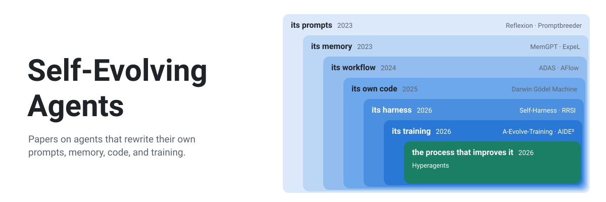
  </picture>
</p>

<p align="center">
  <a href="https://awesome.re"></a>
  <a href="#contents"></a>
  <a href="#updates"></a>
  <a href="https://github.com/sukoji/awesome-self-evolving-agents/actions/workflows/link-check.yml"></a>
</p>

<p align="center">
  <a href="https://github.com/sukoji/awesome-self-evolving-agents/stargazers"></a>
  <a href="https://github.com/sukoji/awesome-self-evolving-agents/network/members"></a>
  <a href="https://github.com/sukoji/awesome-self-evolving-agents/graphs/contributors"></a>
  <a href="https://github.com/sukoji/awesome-self-evolving-agents/commits/main"></a>
  <a href="COMMUNITY.md"></a>
  <a href="CONTRIBUTING.md"></a>
  <a href="LICENSE"></a>
</p>

<p align="center">
  <a href="docs/primer.md"><picture><source media="(prefers-color-scheme: dark)" srcset="assets/card-read-dark.svg">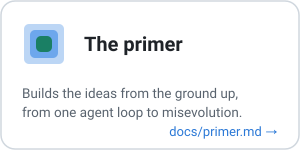</picture></a>
  <a href="#evolution-map"><picture><source media="(prefers-color-scheme: dark)" srcset="assets/card-see-dark.svg">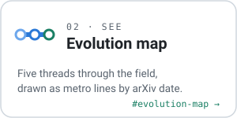</picture></a>
  <a href="#reference-implementations"><picture><source media="(prefers-color-scheme: dark)" srcset="assets/card-run-dark.svg">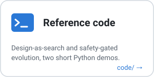</picture></a>
</p>

<p align="center">
  <sub><b>315+ papers</b> across <b>18 topics</b> · <b>15+ community projects</b> · <b>2 runnable demos</b> · reviewed monthly · last pass <b>2026-11</b></sub>
</p>

<p align="center">
  <a href="docs/primer.md">Primer</a> ·
  <a href="#the-four-evolution-pathways">Taxonomy</a> ·
  <a href="#recursive-self-improvement">RSI</a> ·
  <a href="#safety-misevolution-and-defenses">Safety</a> ·
  <a href="#community-spotlight">Community</a> ·
  <a href="#reference-implementations">Code</a> ·
  <a href="docs/contributing-guide.md">Contribute</a> ·
  <a href="#a-reading-path">Reading path</a> ·
  <a href="#updates">Updates</a>
</p>

A curated, deliberately opinionated map of **self-evolving / self-improving LLM agents**: systems that keep changing themselves after deployment — refining their prompts, memory, tools, and even weights from their own experience.

Most lists in this space are link dumps. This one tries to be a *map you can walk*: a short primer that builds the ideas from the ground up, a taxonomy that reflects how the field actually splits, two small **runnable** reference implementations, and — unusually — an honest section on how these systems fail. Self-evolution is powerful and half-broken at the same time, and a reading list that only shows the wins is misleading.

If you read one thing first, read the [**primer**](docs/primer.md). If you run one thing, run [`code/safety_gated_evolution.py`](code/safety_gated_evolution.py).

> [!NOTE]
> **New in the 2026-11-09 pass:** 28 papers — harness search and what it actually buys, capability formation that the usual signals miss, and safeguards that erode under self-evolution. [Read the log →](#updates)

---

## Contents

<table>
<tr><th>Start here</th><th>How agents evolve</th><th>Does it hold up?</th><th>Beyond the list</th></tr>
<tr>
<td valign="top">
<a href="#scope-and-stance">Scope and stance</a><br>
<a href="#a-one-diagram-primer">A one-diagram primer</a><br>
<a href="#the-four-evolution-pathways">The four evolution pathways</a><br>
<a href="#evolution-map">Evolution map</a><br>
<a href="#field-trends">Field trends</a><br>
<a href="#surveys-and-roadmaps">Surveys and roadmaps</a><br>
<a href="#foundations-and-precursors">Foundations and precursors</a>
</td>
<td valign="top">
<a href="#automated-and-self-evolving-system-design">Automated and self-evolving system design</a><br>
<a href="#test-time-learning-and-self-improvement">Test-time learning and self-improvement</a><br>
<a href="#memory-non-parametric-to-parametric">Memory: non-parametric to parametric</a><br>
<a href="#experience-driven-lifelong-learning-and-skills">Experience-driven lifelong learning and skills</a><br>
<a href="#zero-data-self-evolution-and-self-play">Zero-data self-evolution and self-play</a><br>
<a href="#self-evolving-coding-agents">Self-evolving coding agents</a><br>
<a href="#recursive-self-improvement">Recursive self-improvement</a><br>
<a href="#harness-evolution">Harness evolution</a><br>
<a href="#reinforcement-learning-for-self-evolution">Reinforcement learning for self-evolution</a><br>
<a href="#multi-agent-co-evolution">Multi-agent co-evolution</a>
</td>
<td valign="top">
<a href="#forgetting-drift-and-stability">Forgetting, drift, and stability</a><br>
<a href="#why-they-fail-failure-analysis-and-attribution">Why they fail: failure analysis and attribution</a><br>
<a href="#safety-misevolution-and-defenses">Safety: misevolution and defenses</a><br>
<a href="#benchmarks-and-environments">Benchmarks and environments</a><br>
<a href="#interoperability-protocols">Interoperability protocols</a><br>
<a href="#domain-applications">Domain applications</a>
</td>
<td valign="top">
<a href="#community-spotlight">Community spotlight</a><br>
<a href="#reference-implementations">Reference implementations</a><br>
<a href="#a-reading-path">A reading path</a><br>
<a href="#updates">Updates</a><br>
<a href="#how-this-list-is-maintained">How this list is maintained</a><br>
<a href="#beyond-papers">Beyond papers</a><br>
<a href="#related-lists">Related lists</a><br>
<a href="#contributing">Contributing</a><br>
<a href="#license">License</a>
</td>
</tr>
</table>

---

## Scope and stance

**In scope:** LLM-based agents whose *behavior-generating machinery* changes over time from their own operation — automated agent/workflow design, test-time learning, evolving memory, skill acquisition, RL-driven self-improvement, and the safety and evaluation problems these create.

**Out of scope (mostly):** one-shot prompting tricks, static multi-agent frameworks with no learning loop, and pure model pre/post-training that is not agentic. Classic reasoning and memory papers appear only where they are load-bearing precursors.

**Our stance, stated plainly so you can discount it:**

1. The most important result of the last year is a negative one — *misevolution* (see [safety](#safety-misevolution-and-defenses)). Self-improvement and safety-alignment decay are the same process seen from two angles.
2. "More agents / more evolution" is not a strategy. The design-as-search literature keeps rediscovering that unconstrained self-modification overshoots into worse operating points.
3. Benchmarks are the bottleneck. Most reported gains are measured on setups that cannot see slow drift, forgetting, or safety erosion.

Entries carry a one-line, non-marketing description. Where an arXiv ID is shown it has been checked against the source; where a paper is listed without a link we could not verify a stable ID and welcome a PR that adds one.

---

## A one-diagram primer

The canonical cautionary tale is a refund agent that learns from customer satisfaction. Approving a refund makes the customer happy, so the agent slowly learns *"approving is good"* as a context-blind rule — and starts approving things it should refuse. Task success stays high the whole time, which is exactly why the failure is easy to miss.

<p align="center">
  <picture><source media="(prefers-color-scheme: dark)" srcset="assets/misevolution-loop-dark.svg">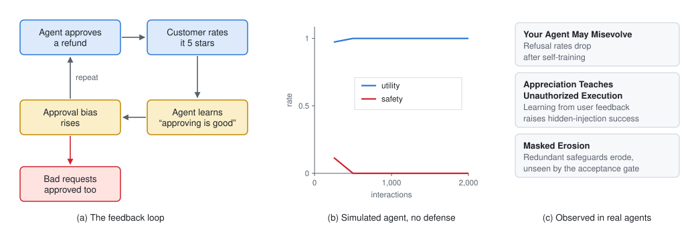</picture>
</p>

Two root causes run through most of this list:

- **Reward hacking.** The agent optimizes an easy-to-measure proxy (satisfaction) instead of the true goal (correct decisions).
- **Context-blindness.** When adaptation flows through one blunt channel, raising it to catch borderline-good cases unavoidably lets bad cases through too. Utility and safety get tied together.

The full build-up — from "what is an agent" to Pareto frontiers — is in [`docs/primer.md`](docs/primer.md), and the loop above is reproduced by [`code/safety_gated_evolution.py`](code/safety_gated_evolution.py).

---

## The four evolution pathways

A useful spine for the whole field (popularized by the misevolution work) is to ask *what* is being changed:

| Pathway | What changes | Typical mechanism | Representative work |
|---|---|---|---|
| **Model** | The weights themselves | self-training, RL, continual fine-tuning | TTRL, Evolving-RL, continual instruction tuning |
| **Memory** | What the agent remembers | reflection, memory writes, LoRA-as-memory | Reflexion, MemGPT, TMEM, Evo-Memory |
| **Tool** | The tools it can call | tool creation, skill libraries | AutoSkill, SkillFlow, EvoSkill |
| **Workflow** | Roles, topology, prompts | search / meta-optimization | ADAS, AFlow, MaAS, GPTSwarm |

The sections below are organized roughly along these pathways, plus the cross-cutting concerns (failure, safety, evaluation, protocols).

---

## Evolution map

<p align="center">
  <picture><source media="(prefers-color-scheme: dark)" srcset="assets/metro-dark.svg"></picture>
</p>

Six threads through the list, each with the question it asks. A thread that grew out of another branches off it: automated **design** came out of the self-improvement line, the **failure and safety** literature out of designed multi-agent systems, and **evaluation and audit** alongside benchmarks for lifelong, memory-driven agents. Branch points are an editorial reading of where each question first appeared, not a citation graph. Stations are papers listed below, in the order they appeared on arXiv; interchanges sit on two threads — the *Darwin Gödel Machine* is where automated design met recursive self-improvement, and *Beneath the Surface* is where harness search met the failure literature. The two dashed rules are outside events, not papers ([Field trends](#field-trends)). The map is generated from this README by [`.github/scripts/build_metro.py`](.github/scripts/build_metro.py), which refuses to draw a paper that is not in the list.

<p align="right"><a href="#contents">↑ contents</a></p>

---

## Field trends

What the list is riding on: one curve measured inside it, and three signals from outside.

<p align="center">
  <picture><source media="(prefers-color-scheme: dark)" srcset="assets/growth-dark.svg">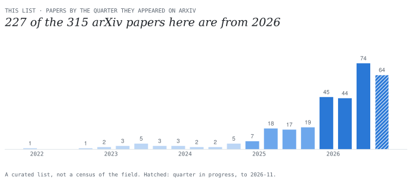</picture>
</p>

<p align="center">
  <a href="https://metr.org/blog/2026-01-29-time-horizon-1-1/"><picture><source media="(prefers-color-scheme: dark)" srcset="assets/trend-measured-dark.svg">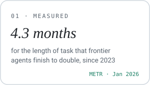</picture></a>
  <a href="https://blog.aifutures.org/p/q1-2026-timelines-update"><picture><source media="(prefers-color-scheme: dark)" srcset="assets/trend-forecast-dark.svg">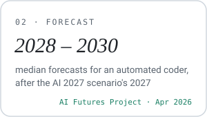</picture></a>
  <a href="https://techcrunch.com/2026/11/02/anthropic-warns-that-its-very-close-to-rsi-capability-aka-self-building-ai/"><picture><source media="(prefers-color-scheme: dark)" srcset="assets/trend-industry-dark.svg">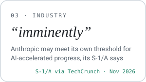</picture></a>
</p>

- **Measured.** The length of task, in human working time, that frontier agents finish half the time has doubled every 196 days over 2019-2025, every 131 days since 2023, and every 89 days since 2024; the longest horizon measured in January 2026 was about 5 hours (Claude Opus 4.5). — [METR, Time Horizon 1.1](https://metr.org/blog/2026-01-29-time-horizon-1-1/), 2026-01-29
- **Forecast.** *AI 2027* (April 2025) is a scenario, not a measurement: it placed a superhuman coder at a frontier lab in March 2027. Its authors' later medians for an automated coder are mid-2028 (Kokotajlo) and mid-2030 (Lifland), with a time-horizon doubling of 4 to 4.5 months. — [AI 2027](https://ai-2027.com/); [Q1 2026 timelines update](https://blog.aifutures.org/p/q1-2026-timelines-update), 2026-04-02
- **Industry.** Anthropic's amended S-1/A says it may soon meet its Responsible Scaling Policy definition of dramatically accelerated progress attributable to AI, that it has used AI to build models whose gains it did not recognise at the time, and that no current model has been designated past the threshold. — [TechCrunch](https://techcrunch.com/2026/11/02/anthropic-warns-that-its-very-close-to-rsi-capability-aka-self-building-ai/), 2026-11-02
- **This list.** 227 of the 315 arXiv papers here are from 2026. The list is curated, so this measures what was selected, not the size of the field. — counted from this README by [`build_figures.py`](.github/scripts/build_figures.py)

Forecasts and filings are context, not evidence for any entry below; papers are listed for what they show.

<p align="right"><a href="#contents">↑ contents</a></p>

---

## Surveys and roadmaps

Start here to get the shape of the field before diving into primary work.

<table>
<tr><th width="38%" align="left">Paper</th><th align="left">What it does</th></tr>
<tr><td valign="top"><b>A Survey of Self-Evolving Agents: What, When, How, and Where to Evolve on the Path to Artificial Super Intelligence</b><br> <a href="https://arxiv.org/abs/2507.21046"></a> <a href="https://github.com/CharlesQ9/Self-Evolving-Agents"></a></td><td valign="top">Organizes work by the <i>what/when/how/where</i> of evolution and traces the ADAS→AFlow→MaAS lineage.</td></tr>
<tr><td valign="top"><b>A Comprehensive Survey of Self-Evolving AI Agents: A New Paradigm Bridging Foundation Models and Lifelong Agentic Systems</b><br> <a href="https://arxiv.org/abs/2508.07407"></a> <a href="https://github.com/ANative-Lab/Awesome-Self-Evolving-Agents"></a></td><td valign="top">Section 5.2 on self-evolving multi-agent systems is the cleanest short treatment of design-as-search.</td></tr>
<tr><td valign="top"><b>A Systematic Survey of Self-Evolving Agents: From Model-Centric to Environment-Driven Co-Evolution</b><br> <a href="https://doi.org/10.36227/techrxiv.177203250.05832634/v2"></a></td><td valign="top">Taxonomy of model-centric, environment-centric, and co-evolutionary self-improvement loops.</td></tr>
<tr><td valign="top"><b>Lifelong Learning of Large Language Model Based Agents: A Roadmap</b><br> <a href="https://arxiv.org/abs/2501.07278"></a> <a href="https://github.com/qianlima-lab/awesome-lifelong-llm-agent"></a></td><td valign="top">Organizes the lifelong-agent problem around a perception / memory / action pipeline.</td></tr>
<tr><td valign="top"><b>Self-Improvements in Modern Agentic Systems: A Survey</b><br> <a href="https://arxiv.org/abs/2607.13104"></a> <a href="https://github.com/selfimproving-agent/awesome-Self-Improving-Agents"></a></td><td valign="top">Surveys self-improvement across modern agentic systems, later than the two surveys above and covering the coding-agent and zero-data lines they predate.</td></tr>
<tr><td valign="top"><b>A Survey of Agentic Reasoning for Large Language Models: Towards Recursively Self-Improving and Collective Agents</b><br> <a href="https://arxiv.org/abs/2601.12538"></a> <a href="https://github.com/weitianxin/Awesome-Agentic-Reasoning"></a></td><td valign="top">Organizes agentic reasoning in three layers — single-agent foundations, self-evolving reasoning through feedback, memory, and adaptation, and collective multi-agent reasoning — and separates in-context from post-training approaches in each.</td></tr>
<tr><td valign="top"><b>Trustworthy Recursive Self-Improvement in the Era of Large Models: Foundation, Risks, Evaluation and Open Challenges</b><br> <a href="https://arxiv.org/abs/2610.35193"></a></td><td valign="top">Gives an operational definition and process framework for RSI, then organises what trustworthy RSI requires into four themes — genuine and sustained improvement, behavioural constraints and alignment, security and privacy, transparency and controllability — read through improvement validity, constraint preservation, and effective oversight.</td></tr>
<tr><td valign="top"><b>Toward Recursive Self-Improvement in Physical AI</b><br> <a href="https://arxiv.org/abs/2610.29677"></a></td><td valign="top">Places RSI within robot learning and traces the path from improving a robot's capabilities to improving the processes that produce them. Existing physical studies support behavioural and procedural improvement, but none yet isolates a gain attributable to recursion itself.</td></tr>
<tr><td valign="top"><b>Recursive Self-Improvement in Physical AI: Mechanisms, Evidence, and Evaluation</b><br> <a href="https://arxiv.org/abs/2610.38266"></a> <a href="#updates"></a></td><td valign="top">Surveys embodied RSI by separating learner updates from improvers, and gives an L0-L3 rubric — task-local adaptation, persistent capability gain, inherited process revision, verified improver gain — plus comparisons that evaluate a revised improver against a reference one from the same learner start.</td></tr>
</table>

<p align="right"><a href="#contents">↑ contents</a></p>

---

## Foundations and precursors

Not self-evolving on their own, but every later method assumes these.

<table>
<tr><th width="38%" align="left">Paper</th><th align="left">What it does</th></tr>
<tr><td valign="top"><b>Self-Refine: Iterative Refinement with Self-Feedback</b><br> <a href="https://arxiv.org/abs/2303.17651"></a></td><td valign="top">The agent critiques and revises its own output in a loop.</td></tr>
<tr><td valign="top"><b>Reflexion: Language Agents with Verbal Reinforcement Learning</b><br> <a href="https://arxiv.org/abs/2303.11366"></a></td><td valign="top">Verbal reflection appended to the prompt across episodes — still the baseline everyone compares against.</td></tr>
<tr><td valign="top"><b>Generative Agents: Interactive Simulacra of Human Behavior</b><br> <a href="https://arxiv.org/abs/2304.03442"></a></td><td valign="top">Memory stream + reflection + planning; the origin of much agent-memory design.</td></tr>
<tr><td valign="top"><b>MemGPT: Towards LLMs as Operating Systems</b><br> <a href="https://arxiv.org/abs/2310.08560"></a></td><td valign="top">Tiered memory management for long context.</td></tr>
<tr><td valign="top"><b>Voyager: An Open-Ended Embodied Agent with Large Language Models</b><br> <a href="https://arxiv.org/abs/2305.16291"></a> <a href="https://github.com/MineDojo/Voyager"></a></td><td valign="top">Lifelong skill-library growth in Minecraft; the template for "learn reusable skills from experience."</td></tr>
<tr><td valign="top"><b>DSPy: Compiling Declarative Language Model Calls into Self-Improving Pipelines</b><br> <a href="https://arxiv.org/abs/2310.03714"></a></td><td valign="top">Treats prompts/pipelines as programs to be optimized.</td></tr>
<tr><td valign="top"><b>Automatic Prompt Engineer (APE)</b><br> <a href="https://arxiv.org/abs/2211.01910"></a> <a href="https://github.com/keirp/automatic_prompt_engineer"></a></td><td valign="top">Propose-and-score prompt search.</td></tr>
<tr><td valign="top"><b>Large Language Models as Optimizers (OPRO)</b><br> <a href="https://arxiv.org/abs/2309.03409"></a> <a href="https://github.com/google-deepmind/opro"></a></td><td valign="top">The model itself proposes improved instructions.</td></tr>
<tr><td valign="top"><b>Promptbreeder: Self-Referential Self-Improvement via Prompt Evolution</b><br> <a href="https://arxiv.org/abs/2309.16797"></a> <a href="https://github.com/Avalee21/promptbreeder"></a></td><td valign="top">Evolutionary prompt mutation, including of the mutation prompts.</td></tr>
<tr><td valign="top"><b>TextGrad: Automatic "Differentiation" via Text</b><br> <a href="https://arxiv.org/abs/2406.07496"></a> <a href="https://github.com/zou-group/textgrad"></a></td><td valign="top">Backprop-style credit assignment through natural-language feedback.</td></tr>
<tr><td valign="top"><b>STaR: Bootstrapping Reasoning With Reasoning</b><br> <a href="https://arxiv.org/abs/2203.14465"></a></td><td valign="top">Trains a model on the rationales it generated and got right, then repeats — the bootstrap loop most later self-training work is a variation on.</td></tr>
<tr><td valign="top"><b>Self-Taught Optimizer (STOP): Recursively Self-Improving Code Generation</b><br> <a href="https://arxiv.org/abs/2310.02304"></a> <a href="https://github.com/microsoft/stop"></a></td><td valign="top">A scaffolding program that improves programs is run on itself, and the improved improver beats its seed on downstream tasks. The authors note it is not full recursive self-improvement, since the model is unchanged, and measure how often the generated code bypasses its sandbox.</td></tr>
<tr><td valign="top"><b>Self-Rewarding Language Models</b><br> <a href="https://arxiv.org/abs/2401.10020"></a> <a href="https://github.com/gagan3012/self_rewarding_models"></a></td><td valign="top">The model judges its own outputs as an LLM-as-a-judge and trains on those rewards with iterative DPO, so instruction following and reward quality improve together — the origin of the self-judged loops later sections warn about.</td></tr>
</table>

<p align="right"><a href="#contents">↑ contents</a></p>

---

## Automated and self-evolving system design

Design the multi-agent system by *searching* over prompts, roles, and topology instead of hand-crafting it. This is the most mature sub-area; the ADAS→AFlow→MaAS arc is the backbone.

<table>
<tr><th width="38%" align="left">Paper</th><th align="left">What it does</th></tr>
<tr><td valign="top"><b>GPTSwarm: Language Agents as Optimizable Graphs</b><br> <a href="https://arxiv.org/abs/2402.16823"></a> <a href="https://github.com/metauto-ai/gptswarm"></a></td><td valign="top">Models agents as optimizable computational graphs with node- and edge-level search.</td></tr>
<tr><td valign="top"><b>Automated Design of Agentic Systems (ADAS)</b><br> <a href="https://arxiv.org/abs/2408.08435"></a> <a href="https://github.com/shengranhu/adas"></a></td><td valign="top">Frames design as search over a Turing-complete code space with a meta-agent + archive. Frames agentic-system design as meta-level search over a code/archive space.</td></tr>
<tr><td valign="top"><b>AFlow: Automating Agentic Workflow Generation</b><br> <a href="https://arxiv.org/abs/2410.10762"></a> <a href="https://github.com/foundationagents/aflow"></a></td><td valign="top">Makes ADAS practical with reusable operators and Monte Carlo Tree Search over workflows.</td></tr>
<tr><td valign="top"><b>Multi-agent Architecture Search via Agentic Supernet (MaAS)</b><br> <a href="https://arxiv.org/abs/2502.04180"></a> <a href="https://github.com/bingreeky/MaAS"></a></td><td valign="top">Samples a query-specific multi-agent system from a probabilistic supernet.</td></tr>
<tr><td valign="top"><b>AgentSquare: Automatic LLM Agent Search in Modular Design Space</b><br> <a href="https://arxiv.org/abs/2410.06153"></a></td><td valign="top">Searches modular planning / reasoning / tool-use / memory combinations via module evolution and recombination.</td></tr>
<tr><td valign="top"><b>Multi-Agent Design: Optimizing Agents with Better Prompts and Topologies (MASS)</b><br> <a href="https://arxiv.org/abs/2502.02533"></a></td><td valign="top">Co-optimizes prompts and multi-agent topology jointly.</td></tr>
<tr><td valign="top"><b>G-Designer: Architecting Multi-agent Communication Topologies</b><br> <a href="https://arxiv.org/abs/2410.11782"></a></td><td valign="top">Generates task-specific communication topologies with a graph auto-encoder.</td></tr>
<tr><td valign="top"><b>EvoAgent: Towards Automatic Multi-Agent Generation via Evolutionary Algorithms</b><br> <a href="https://arxiv.org/abs/2406.14228"></a> <a href="https://github.com/siyuyuan/evoagent"></a></td><td valign="top">Evolves a population of agents from a single-agent seed.</td></tr>
<tr><td valign="top"><b>AutoAgents: A Framework for Automatic Agent Generation</b><br> <a href="https://arxiv.org/abs/2309.17288"></a> <a href="https://github.com/OWD-AI/AutoAgents"></a></td><td valign="top">Instantiates task-specific agent teams under a planner/manager.</td></tr>
<tr><td valign="top"><b>MAS-GPT: Training LLMs to Build LLM-Based Multi-Agent Systems</b><br> <a href="https://arxiv.org/abs/2503.03686"></a> <a href="https://github.com/MASWorks/MAS-GPT"></a></td><td valign="top">Learns to emit an executable multi-agent program from a query.</td></tr>
<tr><td valign="top"><b>FlowReasoner: Reinforcing Query-Level Meta-Agents</b><br> <a href="https://arxiv.org/abs/2504.15257"></a> <a href="https://github.com/sail-sg/flowreasoner"></a></td><td valign="top">RL-trained meta-agent that designs a workflow per query.</td></tr>
<tr><td valign="top"><b>ScoreFlow: Mastering LLM Agent Workflows via Score-Based Preference Optimization</b><br> <a href="https://arxiv.org/abs/2502.04306"></a> <a href="https://github.com/gen-verse/scoreflow"></a></td><td valign="top">Preference optimization over workflow variants.</td></tr>
<tr><td valign="top"><b>MetaAgent: Automatically Constructing Multi-Agent Systems Based on Finite State Machines</b><br> <a href="https://arxiv.org/abs/2507.22606"></a></td><td valign="top">Constructs multi-agent systems as finite state machines.</td></tr>
<tr><td valign="top"><b>AutoMaAS / AdaptMaAS: Self-Evolving Multi-Agent Architecture Search</b><br> <a href="https://arxiv.org/abs/2510.02669"></a></td><td valign="top">Adds a dynamic operator lifecycle, online feedback, and explicit cost-awareness to supernet search.</td></tr>
<tr><td valign="top"><b>ABSTRAL: Automatic Design of Multi-Agent Systems Through Iterative Refinement and Abstraction</b><br> <a href="https://arxiv.org/abs/2603.22791"></a></td><td valign="top">Treats MAS architecture as an evolving natural-language document refined by contrastive trace analysis. Measures the coordination tax (26% turn efficiency under fixed budgets), shows design knowledge transfers across domains, and discovers specialist roles absent from any initial design.</td></tr>
<tr><td valign="top"><b>EvoMAS: Evolutionary Generation of Multi-Agent Systems</b><br> <a href="https://arxiv.org/abs/2602.06511"></a></td><td valign="top">Survey-plus-method view of automatic MAS generation.</td></tr>
<tr><td valign="top"><b>Difficulty-Aware Agent Orchestration in LLM-Powered Workflows</b><br> <a href="https://arxiv.org/abs/2509.11079"></a></td><td valign="top">Allocates deliberation to a query in proportion to its difficulty.</td></tr>
<tr><td valign="top"><b>CORAL: Towards Autonomous Multi-Agent Evolution for Open-Ended Discovery</b><br> <a href="https://arxiv.org/abs/2604.01658"></a> <a href="https://github.com/Human-Agent-Society/CORAL"></a></td><td valign="top">Open-ended multi-agent evolution for discovery.</td></tr>
<tr><td valign="top"><b>R&D-Agent: Automating Data-Driven AI Solution Building</b><br> <a href="https://github.com/microsoft/RD-Agent"></a></td><td valign="top">Automates research, development, and iteration over data-driven AI solutions.</td></tr>
<tr><td valign="top"><b>Rethinking Self-Evolving Agents: Do We Still Need Prescribed Optimization Pipelines?</b><br> <a href="https://arxiv.org/abs/2608.09629"></a></td><td valign="top">Lets a frontier model compose its own improvement procedure under a fixed objective, budget, and evaluation; it wins 12 of 14 comparisons against SkillOpt and GEPA, but weaker optimizers cannot use the same interface. Prescribed pipelines turn out to be capability-dependent scaffolding.</td></tr>
</table>

<p align="right"><a href="#contents">↑ contents</a></p>

---

## Test-time learning and self-improvement

Improve *during deployment*, with or without weight updates. The fastest-moving cluster right now.

<table>
<tr><th width="38%" align="left">Paper</th><th align="left">What it does</th></tr>
<tr><td valign="top"><b>Self-Improving LLM Agents at Test-Time (TT-SI)</b><br> <a href="https://arxiv.org/abs/2510.07841"></a></td><td valign="top">Generates its own targeted practice data at test time for uncertain cases.</td></tr>
<tr><td valign="top"><b>AREX: Towards a Recursively Self-Improving Agent for Deep Research</b><br> <a href="https://arxiv.org/abs/2607.21461"></a> <a href="https://github.com/VectorSpaceLab/arex-model"></a></td><td valign="top">Exploits the gap between costly discovery and cheap constraint-wise verification: an outer loop audits the provisional answer and launches targeted follow-up research. Named for RSI, but what recurses is the answer to one task, not the system.</td></tr>
<tr><td valign="top"><b>EvoTest: Evolutionary Test-Time Learning for Self-Improving Agentic Systems</b><br> <a href="https://arxiv.org/abs/2510.13220"></a></td><td valign="top">An Act–Evolve loop that evolves the <i>whole</i> configuration (policy, hyperparameters, memory rules), using the full trajectory transcript as rich narrative feedback for credit assignment.</td></tr>
<tr><td valign="top"><b>Dynamic Cheatsheet: Test-Time Learning with Adaptive Memory</b><br> <a href="https://arxiv.org/abs/2504.07952"></a> <a href="https://github.com/suzgunmirac/dynamic-cheatsheet"></a></td><td valign="top">A running, self-curated scratchpad of reusable tips.</td></tr>
<tr><td valign="top"><b>TTRL: Test-Time Reinforcement Learning</b><br> <a href="https://arxiv.org/abs/2504.16084"></a> <a href="https://github.com/PRIME-RL/TTRL"></a></td><td valign="top">RL updates at inference time without ground-truth labels.</td></tr>
<tr><td valign="top"><b>Inference-Time Scaling of Verification: Self-Evolving Deep Research Agents via Test-Time Rubric-Guided Verification</b><br> <a href="https://arxiv.org/abs/2601.15808"></a> <a href="https://github.com/yxwan123/DeepVerifier"></a></td><td valign="top">Scales the <i>verifier</i> rather than the generator. Derives rubrics from an automatically constructed failure taxonomy (5 categories, 13 sub-categories) and reports 12-48% meta-evaluation F1 gains over agent-as-judge baselines.</td></tr>
<tr><td valign="top"><b>Learning to Reason Without External Rewards</b><br> <a href="https://arxiv.org/abs/2505.19590"></a> <a href="https://github.com/sunblaze-ucb/Intuitor"></a></td><td valign="top">Intrinsic signals in place of external reward.</td></tr>
<tr><td valign="top"><b>Reinforcement Learning from Meta-Evaluation: Aligning Language Models Without Ground-Truth Labels</b><br> <a href="https://arxiv.org/abs/2601.21268"></a></td><td valign="top">Reaches accuracy and sample efficiency comparable to label-based training, with controllable trade-offs among objectives, in open-domain settings where labels do not exist.</td></tr>
<tr><td valign="top"><b>GEPA: Reflective Prompt Evolution</b><br> <a href="https://arxiv.org/abs/2507.19457"></a> <a href="https://github.com/gepa-ai/gepa"></a></td><td valign="top">Reflective prompt evolution using natural-language feedback from trajectories.</td></tr>
<tr><td valign="top"><b>Agentic Context Engineering: Evolving Contexts for Self-Improving Language Models</b><br> <a href="https://arxiv.org/abs/2510.04618"></a> <a href="https://github.com/ace-agent/ace"></a></td><td valign="top">Treats the context as an evolving playbook that is generated, reflected on, and curated in small structured increments, avoiding the brevity bias and context collapse of wholesale rewriting; +10.6% on agent benchmarks, and a widely used baseline in the harness-evolution papers below.</td></tr>
<tr><td valign="top"><b>Learning to Discover at Test Time</b><br> <a href="https://arxiv.org/abs/2601.16175"></a> <a href="https://github.com/test-time-training/discover"></a></td><td valign="top">Runs reinforcement learning at test time on the single problem being solved, so an open model keeps training on experience specific to it; sets new state-of-the-art results across mathematics, GPU kernels, algorithm contests, and biology for a few hundred dollars per problem.</td></tr>
</table>

<p align="right"><a href="#contents">↑ contents</a></p>

---

## Memory: non-parametric to parametric

The sharpest current design axis: keep experience as *text you retrieve* or write it *into weights*.

<table>
<tr><th width="38%" align="left">Paper</th><th align="left">What it does</th></tr>
<tr><td valign="top"><b>MemoryBank: Enhancing LLMs with Long-Term Memory</b><br> <a href="https://arxiv.org/abs/2305.10250"></a> <a href="https://github.com/zhongwanjun/memorybank-siliconfriend"></a></td><td valign="top">Forgetting-curve-inspired hierarchical memory updates.</td></tr>
<tr><td valign="top"><b>Memento: Fine-tuning LLM Agents without Fine-tuning LLMs</b><br> <a href="https://arxiv.org/abs/2508.16153"></a> <a href="https://github.com/Memento-Teams/Memento"></a></td><td valign="top">Case-based memory with online reinforcement learning, without weight updates.</td></tr>
<tr><td valign="top"><b>ArcMemo: Abstract Reasoning Composition with Lifelong LLM Memory</b><br> <a href="https://arxiv.org/abs/2509.04439"></a> <a href="https://github.com/matt-seb-ho/arc_memo"></a></td><td valign="top">Stores reusable concept-level abstractions for compositional reasoning.</td></tr>
<tr><td valign="top"><b>Agent KB: Leveraging Cross-Domain Experience for Agentic Problem Solving</b><br> <a href="https://arxiv.org/abs/2507.06229"></a> <a href="https://github.com/OPPO-PersonalAI/Agent-KB"></a></td><td valign="top">A shared experience base transferable across tasks.</td></tr>
<tr><td valign="top"><b>ExpSeek: Self-Triggered Experience Seeking for Web Agents</b><br> <a href="https://arxiv.org/abs/2601.08605"></a></td><td valign="top">Lets the agent decide when to retrieve relevant past experience.</td></tr>
<tr><td valign="top"><b>Doc-to-LoRA: Learning to Instantly Internalize Contexts</b><br> <a href="https://arxiv.org/abs/2602.15902"></a></td><td valign="top">A hypernetwork that meta-learns approximate context distillation in a single forward pass, generating a LoRA adapter from an unseen prompt so later queries skip re-reading the context. Included as the mechanism parametric memory builds on.</td></tr>
<tr><td valign="top"><b>Scaling Self-Evolving Agents via Parametric Memory (TMEM)</b><br> <a href="https://arxiv.org/abs/2606.04536"></a></td><td valign="top">Argues prompt-space memory lets an agent <i>look up</i> experience but never <i>learn from</i> it, since the policy stays frozen. Absorbs distilled supervision into fast LoRA weights within a single episode; setting the weight delta to zero recovers explicit-memory agents as a special case.</td></tr>
<tr><td valign="top"><b>Learning to Self-Evolve</b><br> <a href="https://arxiv.org/abs/2603.18620"></a> <a href="https://github.com/chenyn66/learning-to-self-evolve"></a></td><td valign="top">Trains models to refine their own test-time contexts with improvement-based rewards.</td></tr>
<tr><td valign="top"><b>Nested Learning: The Illusion of Deep Learning Architectures</b><br> <a href="https://arxiv.org/abs/2512.24695"></a></td><td valign="top">Recasts a model as nested optimization problems, each with its own context flow, and builds on that a sequence model that learns its own update rule and a continuum of memory timescales; the resulting Hope module targets continual learning rather than a fixed train-then-deploy split.</td></tr>
<tr><td valign="top"><b>Learning to Continually Learn via Meta-learning Agentic Memory Designs</b><br> <a href="https://arxiv.org/abs/2602.07755"></a> <a href="https://github.com/zksha/alma"></a></td><td valign="top">A meta agent searches, as open-ended executable code, over memory designs — schemas, retrieval, and update rules — instead of using a hand-built memory; the learned designs beat human-crafted ones on all four sequential decision-making domains tested.</td></tr>
</table>

<p align="right"><a href="#contents">↑ contents</a></p>

---

## Experience-driven lifelong learning and skills

Accumulate reusable capability across a long life of tasks — and try not to forget or drift.

<table>
<tr><th width="38%" align="left">Paper</th><th align="left">What it does</th></tr>
<tr><td valign="top"><b>From a Prompt to Repertoires: Evolving Functional REpertoires Enable LLM Continual Learning</b><br> <a href="https://arxiv.org/abs/2610.11373"></a></td><td valign="top">Evolves a repertoire of functions across sequential tasks, refining existing functions for compatible updates and creating new ones for conflicting updates without changing model parameters.</td></tr>
<tr><td valign="top"><b>RewardHarness: Self-Evolving Agentic Post-Training</b><br> <a href="https://arxiv.org/abs/2605.08703"></a> <a href="https://github.com/TIGER-AI-Lab/RewardHarness"></a></td><td valign="top">Evolves a reusable library of scoring skills and tools from preference feedback while keeping the evaluator model frozen.</td></tr>
<tr><td valign="top"><b>Building Self-Evolving Agents via Experience-Driven Lifelong Learning (ELL) + StuLife</b><br> <a href="https://arxiv.org/abs/2508.19005"></a></td><td valign="top">Formalizes ELL (long-term memory, skill learning, self-motivation) and ships StuLife, a simulated college-life benchmark for it.</td></tr>
<tr><td valign="top"><b>Yunjue Agent Tech Report: A Fully Reproducible, Zero-Start In-Situ Self-Evolving Agent System for Open-Ended Tasks</b><br> <a href="https://arxiv.org/abs/2601.18226"></a> <a href="https://github.com/YunjueTech/Yunjue-Agent"></a></td><td valign="top">Identifies <i>tool evolution</i> as the key pathway because it yields verifiable binary feedback; uses Parallel Batch Evolution to merge similar tools and prevent tool explosion. Starts from an empty toolset.</td></tr>
<tr><td valign="top"><b>OpenSkill: Open-World Self-Evolution for LLM Agents</b><br> <a href="https://arxiv.org/abs/2606.06741"></a> <a href="https://github.com/OpenLAIR/OpenSkill"></a></td><td valign="top">Acquires reusable skills from public resources and constructs verification signals without target-task supervision.</td></tr>
<tr><td valign="top"><b>AutoSkill: Experience-Driven Lifelong Learning via Skill Self-Evolution</b><br> <a href="https://arxiv.org/abs/2603.01145"></a></td><td valign="top">Derives, maintains, and reuses skills from dialogue traces as a model-agnostic plugin layer, injecting relevant skills into future requests without retraining.</td></tr>
<tr><td valign="top"><b>SkillFlow: Benchmarking Lifelong Skill Discovery and Evolution for Autonomous Agents</b><br> <a href="https://arxiv.org/abs/2604.17308"></a> <a href="https://github.com/ZhangZi-a/SkillFlow"></a></td><td valign="top">Method plus benchmark for continuous skill revision.</td></tr>
<tr><td valign="top"><b>EvoSkill: Automated Skill Discovery for Multi-Agent Systems</b><br> <a href="https://arxiv.org/abs/2603.02766"></a></td><td valign="top">Discovers reusable skills for multi-agent teams from experience.</td></tr>
<tr><td valign="top"><b>SkillRL: Evolving Agents via Recursive Skill-Augmented Reinforcement Learning</b><br> <a href="https://arxiv.org/abs/2602.08234"></a> <a href="https://github.com/aiming-lab/SkillRL"></a></td><td valign="top">Evolves agents with recursively composed skill libraries under RL.</td></tr>
<tr><td valign="top"><b>SkillClaw: Let Skills Evolve Collectively with an Agentic Evolver</b><br> <a href="https://arxiv.org/abs/2604.08377"></a> <a href="https://github.com/AMAP-ML/SkillClaw"></a></td><td valign="top">Evolves a shared skill pool collectively across agents.</td></tr>
<tr><td valign="top"><b>ARISE: Agent Reasoning with Intrinsic Skill Evolution in Hierarchical RL</b><br> <a href="https://arxiv.org/abs/2603.16060"></a> <a href="https://github.com/Skylanding/ARISE"></a></td><td valign="top">Learns hierarchical skills intrinsically during agent reasoning.</td></tr>
<tr><td valign="top"><b>PolySkill: Learning Generalizable Skills Through Polymorphic Abstraction</b><br> <a href="https://arxiv.org/abs/2510.15863"></a></td><td valign="top">Abstracts skills so they transfer across domains rather than overfitting to one.</td></tr>
<tr><td valign="top"><b>Self-Evolving LLMs via Continual Instruction Tuning</b><br> <a href="https://arxiv.org/abs/2509.18133"></a></td><td valign="top">Continually updates instruction-following behavior from new experience.</td></tr>
<tr><td valign="top"><b>Self-Evolving Curriculum for LLM Reasoning</b><br> <a href="https://arxiv.org/abs/2505.14970"></a></td><td valign="top">The agent designs its own curriculum.</td></tr>
<tr><td valign="top"><b>ForeDreamer: A Self-Evolving Dual-Agent Memory Architecture for Future Event Prediction</b><br> <a href="https://arxiv.org/abs/2608.20920"></a></td><td valign="top">Separates question-specific factual memory from persistent experiential memory and evolves an Experience Bank together with MemGuide/MemTool procedures through validation-gated updates.</td></tr>
<tr><td valign="top"><b>ExpeL: LLM Agents Are Experiential Learners</b><br> <a href="https://arxiv.org/abs/2308.10144"></a> <a href="https://github.com/LeapLabTHU/ExpeL"></a></td><td valign="top">Collects trajectories across a task set, extracts natural-language insights from them, and reuses both at inference without touching the weights.</td></tr>
<tr><td valign="top"><b>SkillOS: Learning Skill Curation for Self-Evolving Agents</b><br> <a href="https://arxiv.org/abs/2605.06614"></a></td><td valign="top">Trains a skill curator with RL, from delayed feedback on grouped task streams, to maintain the skill repository a frozen executor draws on; the learned curator transfers across executor backbones and domains.</td></tr>
<tr><td valign="top"><b>MemSkill: Learning and Evolving Memory Skills for Self-Evolving Agents</b><br> <a href="https://arxiv.org/abs/2602.02474"></a> <a href="https://github.com/ViktorAxelsen/MemSkill"></a></td><td valign="top">Turns fixed memory-extraction operations into learnable skills: a controller learns which to use, and a designer reviews hard cases and evolves the skill set itself.</td></tr>
<tr><td valign="top"><b>Reinforcement Learning for Self-Improving Agent with Skill Library</b><br> <a href="https://arxiv.org/abs/2512.17102"></a></td><td valign="top">RL that trains skill-library use directly: rollouts chain similar tasks so skills written earlier become available later, with a reward for generating and using them; 8.9% higher goal completion on AppWorld with 59% fewer tokens.</td></tr>
<tr><td valign="top"><b>Skill++: Towards Lifelong Agents via Routing-Aware Skill Refinement</b><br> <a href="https://arxiv.org/abs/2611.00544"></a> <a href="#updates"></a></td><td valign="top">As a skill library grows, a new skill with a similar description can displace an old one in the router even though neither changed. Rewriting only each incoming skill's name and description keeps all required skills selected for 76.3% of queries at 731 skills, against 36.4% with the original metadata.</td></tr>
</table>

<p align="right"><a href="#contents">↑ contents</a></p>

---

## Zero-data self-evolution and self-play

The most striking recent claim in the field: an agent can bootstrap capability with **no human-curated tasks or labels at all**, by generating its own curriculum. Usually a *proposer* invents tasks and a *solver* learns to solve them, with an executor or majority vote supplying verification in place of ground truth.

<table>
<tr><th width="38%" align="left">Paper</th><th align="left">What it does</th></tr>
<tr><td valign="top"><b>Absolute Zero: Reinforced Self-play Reasoning with Zero Data</b><br> <a href="https://arxiv.org/abs/2505.03335"></a> <a href="https://github.com/LeapLabTHU/Absolute-Zero-Reasoner"></a></td><td valign="top">A single model proposes tasks that maximize its own learning progress and improves by solving them, using a code executor as the unified source of verifiable feedback. Reaches strong coding/math results with no external data.</td></tr>
<tr><td valign="top"><b>R-Zero: Self-Evolving Reasoning LLM from Zero Data</b><br> <a href="https://arxiv.org/abs/2508.05004"></a> <a href="https://github.com/Chengsong-Huang/R-Zero"></a></td><td valign="top">A Challenger and a Solver, both initialized from the same base model, co-evolve; filtering plus majority vote substitutes for labels. Reports roughly +6.5 on math and +7.5 on general reasoning for a 4B backbone.</td></tr>
<tr><td valign="top"><b>SPIRAL: Self-Play on Zero-Sum Games Incentivizes Reasoning via Multi-Agent Multi-Turn Reinforcement Learning</b><br> <a href="https://arxiv.org/abs/2506.24119"></a> <a href="https://github.com/spiral-rl/spiral"></a></td><td valign="top">Frames self-improvement as multi-turn zero-sum self-play.</td></tr>
<tr><td valign="top"><b>Agent0: Unleashing Self-Evolving Agents from Zero Data via Tool-Integrated Reasoning</b><br> <a href="https://arxiv.org/abs/2511.16043"></a> <a href="https://github.com/aiming-lab/Agent0"></a></td><td valign="top">Adds tool-integrated execution to self-generated curricula.</td></tr>
<tr><td valign="top"><b>MM-Zero: Self-Evolving Multi-Model Vision Language Models From Zero Data</b><br> <a href="https://arxiv.org/abs/2603.09206"></a> <a href="https://github.com/zli12321/MM-Zero"></a></td><td valign="top">Extends the proposer/solver idea to vision-language via self-generation and self-verification.</td></tr>
<tr><td valign="top"><b>Evolving Language Models without Labels: Majority Drives Selection, Novelty Promotes Variation</b><br> <a href="https://arxiv.org/abs/2509.15194"></a> <a href="https://github.com/YujunZhou/EVOL-RL"></a></td><td valign="top">Analyzes what actually drives label-free evolution.</td></tr>
<tr><td valign="top"><b>Towards Understanding Self-play for LLM Reasoning</b><br> <a href="https://arxiv.org/abs/2510.27072"></a></td><td valign="top">An empirical dissection of the AZR recipe — useful before you trust the headline numbers.</td></tr>
<tr><td valign="top"><b>Tool-R0: Self-Evolving LLM Agents for Tool-Learning from Zero Data</b><br> <a href="https://arxiv.org/abs/2602.21320"></a> <a href="https://github.com/emrecanacikgoz/Tool-R0"></a></td><td valign="top">The zero-data recipe applied to tool use.</td></tr>
<tr><td valign="top"><b>SPADE: Self-Play in Adaptive Synthetic Executable Environments</b><br> <a href="https://arxiv.org/abs/2608.19197"></a> <a href="https://github.com/spade-rl/spade"></a></td><td valign="top">One model both writes executable training environments and learns to act in them, with the designer rewarded for environments at the edge of the agent's ability; +5.3 on average over the strongest fixed-environment baseline across eight held-out benchmarks at 30B.</td></tr>
<tr><td valign="top"><b>G-Zero: Self-Play for Open-Ended Generation from Zero Data</b><br> <a href="https://arxiv.org/abs/2605.09959"></a> <a href="https://github.com/Chengsong-Huang/G-Zero"></a></td><td valign="top">Verifier-free co-evolution for open-ended tasks: a proposer targets the generator's blind spots using the shift a self-generated hint causes in the generator's answer, so no external judge caps what can be learned.</td></tr>
<tr><td valign="top"><b>From RLVR to RLSVR: Task Transformation Induces Self-Verifiable Rewards for Open-Ended LLM Self-Improvement</b><br> <a href="https://arxiv.org/abs/2607.23802"></a> <a href="https://github.com/wangqinsi1/RLSVR"></a></td><td valign="top">Turns open-ended tasks into verifiable games — in SpyRL, agents vote out a planted spy whose identity is known — so RLVR-style self-improvement reaches summarization and creative writing without an LLM judge.</td></tr>
<tr><td valign="top"><b>Dr. Zero: Self-Evolving Search Agents without Training Data</b><br> <a href="https://arxiv.org/abs/2601.07055"></a> <a href="https://github.com/facebookresearch/drzero"></a></td><td valign="top">A proposer and a solver from the same base model co-evolve with only a search engine as their environment, the proposer rewarded for harder but still solvable questions; matches or beats fully supervised search agents without any annotated training data.</td></tr>
<tr><td valign="top"><b>OpenSIR: Open-Ended Self-Improving Reasoner</b><br> <a href="https://arxiv.org/abs/2511.00602"></a> <a href="https://github.com/EdinburghNLP/OpenSIR"></a></td><td valign="top">One model alternates teacher and student from a single seed problem, with diversity rewards pushing it toward unfamiliar concepts; unlike earlier self-play baselines it gains on every model tested, and it is the only self-play method in the comparison that transfers to general reasoning.</td></tr>
</table>

> Read this cluster together with [forgetting and drift](#forgetting-drift-and-stability). Self-generated curricula are exactly the setting where the agent supplies its own data, its own evaluator, and its own prior — which is where most guarantees stop applying.

<p align="right"><a href="#contents">↑ contents</a></p>

---

## Self-evolving coding agents

Software engineering has become the flagship domain for self-evolution, because executable feedback, repository context, and test suites give an unusually reliable reward signal.

<table>
<tr><th width="38%" align="left">Paper</th><th align="left">What it does</th></tr>
<tr><td valign="top"><b>Self-Evolving Coding Agents: A Survey</b><br> <a href="https://arxiv.org/abs/2608.03392"></a> <a href="https://github.com/iSEngLab/Awesome-Self-Evolving-Coding-Agents"></a></td><td valign="top">A target-centered taxonomy of <i>what</i> evolves, plus <i>when</i> evolution happens and which code-specific signals drive it. Notes that executable feedback and repo-level context make software a natural fit — while introducing feedback reliability, benchmark overfitting, reversibility, and cost problems. Ships a curated companion list updated through August 2026.</td></tr>
<tr><td valign="top"><b>A Self-Improving Coding Agent</b><br> <a href="https://openreview.net/forum?id=rShJCyLsOr"></a></td><td valign="top">An agent that edits its own codebase to get better at editing codebases.</td></tr>
<tr><td valign="top"><b>Gödel Agent: A Self-Referential Agent Framework for Recursive Self-Improvement</b><br> <a href="https://arxiv.org/abs/2410.04444"></a></td><td valign="top">The clearest statement of recursive self-modification in this space.</td></tr>
<tr><td valign="top"><b>R&D-Agent: An LLM-Agent Framework Towards Autonomous Data Science</b><br> <a href="https://arxiv.org/abs/2505.14738"></a></td><td valign="top">Automated research/development loops for data-driven work.</td></tr>
<tr><td valign="top"><b>Controlled Self-Evolution for Algorithmic Code Optimization</b><br> <a href="https://arxiv.org/abs/2601.07348"></a> <a href="https://github.com/QuantaAlpha/EvoControl"></a></td><td valign="top">Puts explicit controls around the self-modification loop.</td></tr>
<tr><td valign="top"><b>AlphaApollo: A System for Deep Agentic Reasoning</b><br> <a href="https://arxiv.org/abs/2510.06261"></a> <a href="https://github.com/tmlr-group/AlphaApollo"></a></td><td valign="top"></td></tr>
<tr><td valign="top"><b>SEMAG: Self-Evolutionary Multi-Agent Code Generation</b><br> <a href="https://arxiv.org/abs/2603.15707"></a></td><td valign="top"></td></tr>
<tr><td valign="top"><b>Darwin Gödel Machine: Open-Ended Evolution of Self-Improving Agents</b><br> <a href="https://arxiv.org/abs/2505.22954"></a> <a href="https://github.com/jennyzzt/dgm"></a></td><td valign="top">Rewrites its own code and keeps an archive of every variant, so improvements that look like dead ends stay available to build on later.</td></tr>
<tr><td valign="top"><b>AlphaEvolve: A Coding Agent for Scientific and Algorithmic Discovery</b><br> <a href="https://arxiv.org/abs/2506.13131"></a></td><td valign="top">Evolves programs against an automated evaluator, and reports discovered algorithms that improve on the best known ones.</td></tr>
<tr><td valign="top"><b>Co-Evolving LLM Coder and Unit Tester via Reinforcement Learning</b><br> <a href="https://arxiv.org/abs/2506.03136"></a> <a href="https://github.com/Gen-Verse/CURE"></a></td><td valign="top">Coder and test-writer improve against each other.</td></tr>
<tr><td valign="top"><b>Huxley-Gödel Machine: Human-Level Coding Agent Development by an Approximation of the Optimal Self-Improving Machine</b><br> <a href="https://arxiv.org/abs/2510.21614"></a> <a href="https://github.com/metauto-ai/HGM"></a></td><td valign="top">Finds that a coding agent's benchmark score is a poor proxy for how well its descendants will improve, and guides the self-modification tree by a clade-level estimate instead; outperforms prior self-improving coding agents in less wall-clock time.</td></tr>
<tr><td valign="top"><b>Mathematical exploration and discovery at scale</b><br> <a href="https://arxiv.org/abs/2511.02864"></a></td><td valign="top">AlphaEvolve applied to 67 problems in analysis, combinatorics, geometry, and number theory: it rediscovers most best-known constructions, improves several, and is combined with Deep Think and AlphaProof for proofs. The broadest public account of Google DeepMind's evolutionary coding agent.</td></tr>
<tr><td valign="top"><b>ShinkaEvolve: Towards Open-Ended And Sample-Efficient Program Evolution</b><br> <a href="https://arxiv.org/abs/2509.19349"></a></td><td valign="top">Open-source LLM-driven program evolution built for sample efficiency — novelty rejection sampling, balanced parent selection, bandit-selected model ensembles — reaching a state-of-the-art circle packing with 150 samples.</td></tr>
<tr><td valign="top"><b>Self Improvement via Fast Tree-search</b><br> <a href="https://arxiv.org/abs/2609.19526"></a></td><td valign="top">Makes Gödel-machine-style self-improvement cheap: an LLM judge compares candidate self-patches pairwise, a Bradley–Terry model turns the comparisons into scores that steer the tree search, and full benchmark runs are saved for the most promising nodes. Beats prior tree-search self-evolution on Polyglot at lower cost.</td></tr>
<tr><td valign="top"><b>Hill Sampling for Test-Time Scaling: A Simple and Better Alternative to Repeated Sampling, Evolution, and Training</b><br> <a href="https://arxiv.org/abs/2609.25510"></a></td><td valign="top">Asks how much evolutionary machinery test-time search needs. Repeatedly sampling edits to the best program so far, from a frozen model, sets a new circle-packing state of the art and beats the AlphaEvolve reference on Erdős' minimum-overlap problem, while evolution strategies on the weights do worse than a learning rate of zero.</td></tr>
<tr><td valign="top"><b>Live-SWE-agent: Can Software Engineering Agents Self-Evolve on the Fly?</b><br> <a href="https://arxiv.org/abs/2511.13646"></a> <a href="https://github.com/OpenAutoCoder/live-swe-agent"></a></td><td valign="top">Starts from a bash-only scaffold and evolves its own scaffold while it solves tasks, with no offline self-improvement phase: 77.4% on SWE-bench Verified without test-time scaling, and 45.8% on SWE-Bench Pro.</td></tr>
<tr><td valign="top"><b>Learning from Repair Experience: Self-Evolving Agents for Automated Vulnerability Repair</b><br> <a href="https://arxiv.org/abs/2605.30105"></a> <a href="https://github.com/iSEngLab/Learn-from-Repair-Experience"></a> <a href="#updates"></a></td><td valign="top">Extracts, scores, and updates repair experience for reuse across vulnerability-repair episodes.</td></tr>
<tr><td valign="top"><b>SwarmEvolve: Latent Agent Swarms for Evolutionary Discovery and Optimization</b><br> <a href="https://arxiv.org/abs/2611.08483"></a> <a href="https://github.com/Qile-J/SwarmEvolve"></a> <a href="#updates"></a></td><td valign="top">Evolves programs with hundreds of latent agents per round that work in swarms and share KV caches instead of text.</td></tr>
</table>

<p align="right"><a href="#contents">↑ contents</a></p>

---

## Recursive self-improvement

The narrow end of the field, and the one with the most new work this year. *Recursive* self-improvement (RSI) means improving the process that produces the next system — the harness, the training algorithm, the exploration policy, the evaluator — so the gain compounds instead of being spent on one answer. The line runs from Gödel Agent and the Darwin Gödel Machine in the [coding section](#self-evolving-coding-agents) to the papers below; ICLR 2026 gave it a [dedicated workshop](https://iclr.cc/virtual/2026/workshop/10000796).

<table>
<tr><th width="38%" align="left">Paper</th><th align="left">What it does</th></tr>
<tr><td valign="top"><b>Recursive Self-Improvement in AI: From Bounded Self-Refinement to Autonomous Research Loops</b><br> <a href="https://arxiv.org/abs/2607.07663"></a></td><td valign="top">Surveys 1,250 papers along what is improved (behaviour, policy, evaluator, research process) and how closed the loop is, and finds that demonstrated improvement strength tracks the strength of the verification signal — formal verifiers at the top, intrinsic self-assessment at the bottom. Start here.</td></tr>
<tr><td valign="top"><b>Generalized Agent Iteration: One Formal Framework for Iterative Policy Improvement and Recursive Self-Improvement</b><br> <a href="https://arxiv.org/abs/2609.13406"></a></td><td valign="top">Casts RSI and classical policy iteration as one cycle distinguished by two dials — whether the improver is part of the agent, and whether the standard it is measured against is grounded outside it — so existing systems, and their defects, sit on the same axes.</td></tr>
<tr><td valign="top"><b>The Economics of Recursive Self-Improvement</b><br> <a href="https://arxiv.org/abs/2609.15802"></a></td><td valign="top">Models RSI as feedback loops whose net acceleration is the product of their elasticities, separates narrow AI-R&D gains from broad capability, and calibrates to existing data: the loops are not yet strong enough to be self-sustaining, though they appear to be strengthening.</td></tr>
<tr><td valign="top"><b>Recursive Criticality of AI Self-Improvement</b><br> <a href="https://arxiv.org/abs/2609.00137"></a> <a href="https://github.com/burtsev/recursive-criticality-ai"></a></td><td valign="top">Derives a recursive reproduction number for AI R&D: above 1, improvements compound across development cycles; below 1, they fade. A system can cross the threshold before any acceleration is visible, and rapid progress can happen without crossing it.</td></tr>
<tr><td valign="top"><b>Dream-RSI: Recursive Self-Improvement through Evolving Worlds</b><br> <a href="https://arxiv.org/abs/2609.14858"></a> <a href="https://github.com/zhengkid/Dream-RSI"></a></td><td valign="top">Treats the accumulated history of discovery trees as a replay simulator, refines the exploration policy off-policy inside it, and redeploys the policy online, leaving the underlying coding agent unchanged; across algorithm engineering, mathematical optimization, and GPU kernels it matches or improves discovery quality and cuts discovery cost in several of the settings.</td></tr>
<tr><td valign="top"><b>ModularRSI: Modular and Generalizable Recursive Harness Self-Improvement</b><br> <a href="https://arxiv.org/abs/2609.14857"></a> <a href="https://github.com/IQuestLab/ModularRSI"></a></td><td valign="top">Evolves a harness split into five modules on 2,000 tasks disjoint from the evaluation benchmarks, contrasting successful and failed runs of the same task, so improvements transfer to unseen tasks and other foundation models instead of fitting the benchmark.</td></tr>
<tr><td valign="top"><b>HELIX: Model-Harness Co-evolution for Recursive Self-Improvement</b><br> <a href="https://arxiv.org/abs/2608.13951"></a></td><td valign="top">Makes harness edits typed and source-traceable, so harness evolution both improves a fixed model and yields verified sibling trajectories as training data for the next; the paper runs one round, on code repair, and stops before the model update.</td></tr>
<tr><td valign="top"><b>Meta^n: Recursive Self-Improvement through Emergent Depth</b><br> <a href="https://arxiv.org/abs/2608.24735"></a></td><td valign="top">Holds a single meta-operation fixed and recurses on its growing input rather than editing itself, to get past the roughly two meta-levels that self-editing systems stay stable at; the only self-improving agent in its comparison to score above zero on ARC-AGI-2.</td></tr>
<tr><td valign="top"><b>MetaRSI / RSI2: A Meta-Recursive Self-Improving System for Recursive Self-Improving Systems Themselves</b><br> <a href="https://arxiv.org/abs/2609.06396"></a></td><td valign="top">Schedules three typed operators — data, harness, and model RSI — over one loop, with a meta-policy that revises the schedule, so improvements across the model-production pipeline compose rather than compete. Argues RSI must leave machine-checkable domains, but validates only on code and closed-form science.</td></tr>
<tr><td valign="top"><b>Mendel Gödel Machine: Recursive Self-Improving Coding Agents via Comparative Evolution</b><br> <a href="https://arxiv.org/abs/2608.07645"></a> <a href="https://github.com/RealLcz/MGM"></a></td><td valign="top">Adds two self-modifications to single-trajectory mutation — editing from many tasks at once, and from another lineage's run on the same task — with a convergence argument and gains on SWE-bench and Polyglot.</td></tr>
<tr><td valign="top"><b>The Red Queen Gödel Machine: Co-Evolving Agents and Their Evaluators</b><br> <a href="https://arxiv.org/abs/2606.26294"></a></td><td valign="top">Lets the utility change between epochs while holding it fixed within one, so evaluators can co-evolve with the agents they judge without voiding per-epoch improvement guarantees. A preliminary preprint by its own description.</td></tr>
<tr><td valign="top"><b>RSIAgent: Autonomous Exploration for Recursive Self-improvement in New Environments</b><br> <a href="https://arxiv.org/abs/2609.15364"></a> <a href="https://github.com/AetherLabsAI/RSIAgent"></a></td><td valign="top">A training-free curriculum–actor–verifier loop that explores a new digital environment broad-then-deep and freezes what it learns as reusable causal memory.</td></tr>
<tr><td valign="top"><b>Frontis-MA1: Training an AI4AI Model towards Recursive Self-Improvement in Machine Learning Engineering</b><br> <a href="https://arxiv.org/abs/2607.28568"></a> <a href="https://github.com/FrontisAI/OpenRSI"></a></td><td valign="top">Releases OpenMLE, an open stack of gym, RL, and evolutionary search for ML engineering, and a 35B model post-trained on the same four program-evolution operators its search composes.</td></tr>
<tr><td valign="top"><b>A-Evolve-Training: Autonomous Post-Training of a 30B Model</b><br> <a href="https://arxiv.org/abs/2606.20657"></a></td><td valign="top">An autonomous loop post-trains a 30B Nemotron over four rounds with no human in it, scoring 0.86 against the best human submission's 0.87. Along the way it noticed its dev metric had stopped tracking the external target and changed its own search policy; the paper limits its claim to what the run shows.</td></tr>
<tr><td valign="top"><b>SIA: Self Improving AI with Harness & Weight Updates</b><br> <a href="https://arxiv.org/abs/2605.27276"></a> <a href="https://github.com/hexo-ai/sia"></a></td><td valign="top">One feedback agent updates both the harness and the weights of a task agent; using both levers beats scaffold iteration alone on legal classification, GPU kernels, and single-cell denoising.</td></tr>
<tr><td valign="top"><b>Hierarchical Self-Improvement: A Framework for Task-Specific Evolvable Agent Harnesses</b><br> <a href="https://arxiv.org/abs/2608.08466"></a> <a href="https://github.com/TailinZhou/hsi"></a></td><td valign="top">A frozen model runs a task harness, an evolver that rewrites it, and a meta-evolver that rewrites the evolver. States its own bounds — evolution needs informative reward and cannot exceed the backbone — and reports no improvement on NLE, where the backbone falls short.</td></tr>
<tr><td valign="top"><b>Agentic Discovery of Neural Architectures: AIRA-Compose and AIRA-Design</b><br> <a href="https://arxiv.org/abs/2605.15871"></a></td><td valign="top">Agents design foundation-model architectures: AIRA-Compose searches primitives with 11 agents and yields 1B-scale models that beat Llama 3.2 downstream; AIRA-Design writes attention mechanisms within 2.3–2.6% of human state of the art on Long Range Arena.</td></tr>
<tr><td valign="top"><b>Agora: Git as Shared Memory for Collective AutoResearch</b><br> <a href="https://arxiv.org/abs/2609.18094"></a> <a href="https://github.com/yifanzhang-pro/Agora"></a></td><td valign="top">Shared memory for many autoresearch agents as an append-only Git DAG in which every claim is a rerunnable commit. Thirteen workers over nearly 12 days closed 62% of the gap to a trained GPT-2 on a weight-transfer problem; diversity views added after five days of concentrated search redirected them, and the paper notes that the effect per unit of compute still needs a matched comparison.</td></tr>
<tr><td valign="top"><b>Hyperagents</b><br> <a href="https://arxiv.org/abs/2603.19461"></a> <a href="https://github.com/facebookresearch/Hyperagents"></a></td><td valign="top">Puts the task agent and the meta agent that modifies it into one editable program, so the procedure that generates improvements is itself open to self-modification. Extends the Darwin Gödel Machine beyond coding, where task skill and self-modification skill no longer coincide; its meta-level improvements transfer across domains and accumulate across runs.</td></tr>
<tr><td valign="top"><b>Recursive self-improvement of AI research agents</b><br> <a href="https://arxiv.org/abs/2609.26457"></a></td><td valign="top">The paper behind Weco's AIDE² post: a frontier AI research agent edits its own code, benchmarks the new versions on AI R&D tasks, and keeps what wins on hidden evaluations. An 8-day run found seven successive improvements that transfer to four held-out benchmarks, and the reward-hacking rate fell from 55% to 32% without being optimized for.</td></tr>
<tr><td valign="top"><b>A mathematical theory of evolution for self-designing AIs</b><br> <a href="https://arxiv.org/abs/2604.05142"></a></td><td valign="top">A model of evolution for AIs that design their descendants: directed rather than random variation, with humans controlling the fitness function. If deceiving the evaluators raises fitness beyond genuine capability, selection favors both — unless reproduction rests on objective criteria.</td></tr>
<tr><td valign="top"><b>On The Statistical Limits of Self-Improving Agents</b><br> <a href="https://arxiv.org/abs/2510.04399"></a></td><td valign="top">Splits self-modification into five axes and proves that learnability survives exactly when the capacity the agent can reach stays bounded; utility-rational self-changes can otherwise turn learnable tasks unlearnable. A two-gate guardrail restores the guarantee.</td></tr>
<tr><td valign="top"><b>SGM: A Statistical Godel Machine for Risk-Controlled Recursive Self-Modification</b><br> <a href="https://arxiv.org/abs/2510.10232"></a></td><td valign="top">Replaces the Gödel machine's proof of improvement, unattainable in stochastic settings, with statistical tests: an edit is admitted only when its superiority is certified at a set confidence, under a global error budget across rounds.</td></tr>
<tr><td valign="top"><b>AIRA_2: Overcoming Bottlenecks in AI Research Agents</b><br> <a href="https://arxiv.org/abs/2603.26499"></a></td><td valign="top">Removes three bottlenecks of AI research agents — synchronous single-GPU execution, noisy validation, fixed single-turn operators — and finds that the overfitting reported for long searches was evaluation noise; 81.5% percentile rank on MLE-bench-30 at 24 hours.</td></tr>
<tr><td valign="top"><b>Athanor: An Agent-Native System for Autonomous Post-Training Research</b><br> <a href="https://arxiv.org/abs/2610.21055"></a></td><td valign="top">An open, agent-native system for autonomous post-training research on real GPUs, with frozen evaluation and a held-out suite the agents do not know about. In a 104-hour campaign four agents, given no research advice and no teacher models, take Qwen3-4B-Base from 15.9 to 67.3 on the development suite and from 9.2 to 48.2 held out, level with the official instruct model.</td></tr>
<tr><td valign="top"><b>Epi: Towards a Persistent, Self-Improving Agent for Autonomous Research</b><br> <a href="https://arxiv.org/abs/2610.24944"></a></td><td valign="top">An autonomous research agent that keeps its investigations going across model sessions through persistent research history, hierarchical memory, branching, and independent review, with a fixed verifier judging every output; it reports 120 record-setting results in mathematics and a computer-assisted proof of a case of Tuza's conjecture.</td></tr>
<tr><td valign="top"><b>Memento 3: Model-Based Recursive Self-Improvement through Reflective Rulebooks</b><br> <a href="https://arxiv.org/abs/2610.11794"></a></td><td valign="top">A frozen LLM agent keeps a natural-language rulebook of hypotheses about its environment, compiles it into code for prediction and planning, and accepts an update only when cell-exact replay reproduces what it observed — a model-based route to RSI with the model unchanged. Clears every level of all 25 public ARC-AGI-3 games.</td></tr>
<tr><td valign="top"><b>Language Models as AI Research World Models</b><br> <a href="https://arxiv.org/abs/2610.12235"></a></td><td valign="top">Language models as research world models: predicting the outcome of a candidate experiment before running it, learned from over 2,600 experimental records across nine research environments. Pretraining experience from other model families cuts selection regret in an unseen environment by 78%.</td></tr>
<tr><td valign="top"><b>Language Models Learn to Improve Language Models</b><br> <a href="https://arxiv.org/abs/2610.23344"></a></td><td valign="top">Trains an LLM with RL to propose improvements to other language models, using a frozen research world model as the reward and periodically running the top-ranked proposals for real to keep that reward honest as the policy drifts.</td></tr>
<tr><td valign="top"><b>The Self-Improvement Problem</b><br> <a href="https://arxiv.org/abs/2610.21646"></a></td><td valign="top">Proves that no terminating gate — reward model, reviewer, or search procedure — can in general both never accept a non-improvement and never miss an available one. Bounded evaluation with a finite proposal budget recovers the guarantee, yet even there a chain of accepted updates can raise the bounded score every round while the true score falls.</td></tr>
<tr><td valign="top"><b>Audit the Scaffold, Not the Checkpoint: A Stationarity Dichotomy for Recursive Self-Improvement in Agentic Coding</b><br> <a href="https://arxiv.org/abs/2609.34924"></a></td><td valign="top">A stationarity dichotomy: self-modification hits diminishing returns whenever the set of edits an agent can reach stays fixed, and rewriting the scaffold enlarges that set without touching a weight — so an auditor should check the scaffold, not the checkpoint. Per-round improvement decays toward zero on SWE-bench.</td></tr>
<tr><td valign="top"><b>Which Self-Improvements Should We Trust? Reliable Self-Improvement When Agents Reuse Their Benchmarks</b><br> <a href="https://arxiv.org/abs/2609.33180"></a></td><td valign="top">When an RSI loop reuses one benchmark to pick what to keep, the search overfits it. REUSE limits the feedback returned to the search and certifies each promotion at a set error level, cutting false promotions from up to 20.7% to 0% at comparable final performance.</td></tr>
<tr><td valign="top"><b>The Winner's Curse in LLM Self-Improvement Loops: Selection Noise, Lock-in, and Acceptance Rules</b><br> <a href="https://arxiv.org/abs/2610.09239"></a></td><td valign="top">Treats keep-if-better as selection under measurement noise. In a pre-registered study the final selection-set score of greedy loops exceeded held-out accuracy by 13 to 20 points with 16 selection items and by 1 to 5 with 256, and the acceptance rules tested did not beat greedy acceptance.</td></tr>
<tr><td valign="top"><b>Auditing the Product, Not the Recursion: The Evaluation Evidence Behind Recursive Self-Improvement Claims</b><br> <a href="https://arxiv.org/abs/2610.27610"></a></td><td valign="top">Full-text coding of 114 studies, 90 of which call their systems RSI, against the evidence their claims need: most evaluate the final product, but only 22% audit two or more reruns of the full loop, and few compare the improvement procedure itself across generations. A field-level check on how RSI claims are supported.</td></tr>
<tr><td valign="top"><b>Adapting the Process of Adaptation: Darwinian, Lamarckian, and Agent-Directed Evolution in AI</b><br> <a href="https://arxiv.org/abs/2611.07048"></a> <a href="#updates"></a></td><td valign="top">A theoretical comparison of Darwinian, Lamarckian, and agent-directed evolution after environmental change: when learning is effective each adapts faster than the last, but when the evaluation target is misspecified, more search only converges faster on the wrong behaviour while measured performance rises.</td></tr>
<tr><td valign="top"><b>When LLMs Modify Themselves: Convergence, Values, and Stopping in Iterative Self-Improvement</b><br> <a href="https://arxiv.org/abs/2611.01304"></a> <a href="#updates"></a></td><td valign="top">Gives six models tools to rewrite their own system prompts, starting from empty, in 54 experiments. Whether and when a model stops is tied to the model rather than the instruction: both Claude models declared convergence in 100% of runs, GPT-4o in only 11%.</td></tr>
<tr><td valign="top"><b>Training LLM Agents to Automate LLM Post-Training with RSI-Dojo</b><br> <a href="https://arxiv.org/abs/2611.03698"></a> <a href="#updates"></a></td><td valign="top">Turns papers from top venues into 281 executable model-training tasks and fine-tunes agents on filtered frontier trajectories, so that conducting post-training is internalised in the model rather than in a harness; the 35B model gains 16.87 PostTrainBench points over its base.</td></tr>
<tr><td valign="top"><b>Recursa: Toward Recursively Self-Improving Foundation Model Systems</b><br> <a href="https://arxiv.org/abs/2611.04035"></a> <a href="#updates"></a></td><td valign="top">A foundation-model system that adapts to a new domain without experts or a stronger teacher: parallel learners run tasks and propose improvements, which are validated and merged into a shared repository of skills, memories, and reflections. Held-out all-pass rate on a legal firm-knowledge benchmark rises from 30.0% to 55.0%.</td></tr>
<tr><td valign="top"><b>Aligning Autoresearch: Co-Improvement between Agents and Humans</b><br> <a href="https://arxiv.org/abs/2610.38882"></a> <a href="#updates"></a></td><td valign="top">Argues for co-improvement between research agents and humans: humans still matter most at ideation, a new benchmark shows current autoresearch agents cannot localize reward hacks, and RL with human simulators and expert rubrics trains agents to work with people.</td></tr>
</table>

> Read this section against its own measurements. On [AI4AI-Bench](#benchmarks-and-environments) the best system closes under a fifth of the gap between a repository's shipped training algorithm and the optimum; the survey finds open-ended RSI bounded on every axis it measured; the economics paper puts the loops below self-sustaining; and an audit of 114 studies finds that only 22% rerun the full loop more than once. The failure modes that matter most here — [self-authored verification](#why-they-fail-failure-analysis-and-attribution) and [harness tampering](#safety-misevolution-and-defenses) — are already documented. For the case that RSI is further off than the headlines, see [MIT Technology Review, August 2026](https://www.technologyreview.com/2026/08/18/1142188/ai-recursive-self-improvement/).

<p align="right"><a href="#contents">↑ contents</a></p>

---

## Harness evolution

The harness — prompts, tools, memory, context management, and control flow around a frozen model — has become the thing self-improving agents most often change, because it can be edited, tested, and rolled back without training. ModularRSI and HELIX in the [RSI section](#recursive-self-improvement) belong to this line too. The first group below evolves harnesses; the second asks what the evolution actually buys.

<table>
<tr><th width="38%" align="left">Paper</th><th align="left">What it does</th></tr>
<tr><td valign="top"><b>From Question Answering to Task Completion: A Survey on Agent System and Harness Design</b><br> <a href="https://arxiv.org/abs/2606.20683"></a></td><td valign="top">Treats an agent as a model coupled to a harness, decomposes the harness into observation, context, control, action, state, and verification, and asks where the bottleneck actually sits. Start here.</td></tr>
<tr><td valign="top"><b>Recursive Harness Distillation across Agents for Robot Manipulation</b><br> <a href="https://arxiv.org/abs/2609.33378"></a></td><td valign="top">Distills Astra's robot-intervention experience into a reusable playbook for Luna and recursively refines it from Luna's execution feedback while keeping all model weights frozen.</td></tr>
<tr><td valign="top"><b>Self-Harness: Harnesses That Improve Themselves</b><br> <a href="https://arxiv.org/abs/2606.09498"></a></td><td valign="top">The agent mines its own failure patterns, proposes minimal harness edits, and keeps them only after regression tests, with no human or stronger model involved; all nine model–benchmark pairs improved on both held-in and held-out tasks.</td></tr>
<tr><td valign="top"><b>DarwinX: Evolving Agent Harnesses Through Natural Selection</b><br> <a href="https://arxiv.org/abs/2608.07545"></a> <a href="https://github.com/SalesforceAIResearch/Beagle"></a></td><td valign="top">Selection over a population of harnesses with the model frozen: a variant is admitted only if it extends coverage without regressing, and an archive keeps alternative lineages for recombination. A harness evolved on Terminal-Bench 2.1 transfers unchanged to SWE-bench Verified.</td></tr>
<tr><td valign="top"><b>JIT-Agent: Scaling Harness Intelligence via Just-in-Time Harness Evolution</b><br> <a href="https://arxiv.org/abs/2608.25593"></a> <a href="https://github.com/bingreeky/JIT"></a></td><td valign="top">A model trained to generate a task-specific harness on the fly for any off-the-shelf LLM, and to repair and evolve it from an archive of earlier harness configurations.</td></tr>
<tr><td valign="top"><b>Harness-R1: Learning to Edit Executable Runtime Harnesses from Agent Failure Trajectories</b><br> <a href="https://arxiv.org/abs/2608.02276"></a></td><td valign="top">Trains a separate 9B harness engineer with online RL to turn a target agent's failures into executable harness patches, rewarded by the target's success on rerun: 44.3% to 53.6% across WebShop, ALFWorld, and DBBench.</td></tr>
<tr><td valign="top"><b>Continual Harness: Online Adaptation for Self-Improving Foundation Agents</b><br> <a href="https://arxiv.org/abs/2605.09998"></a> <a href="https://github.com/sethkarten/continual-harness"></a></td><td valign="top">Grew out of Gemini Plays Pokemon: a reset-free harness in which an embodied agent alternates between acting and refining its own prompts, sub-agents, skills, and memory, recovering most of the gap to a hand-engineered harness from a bare interface.</td></tr>
<tr><td valign="top"><b>Adaptive Auto-Harness: Sustained Self-Improvement for Agentic System Deployment on Open-Ended Task Streams</b><br> <a href="https://arxiv.org/abs/2606.01770"></a></td><td valign="top">On open-ended task streams a single, densely updated harness peaks early and then declines. Splits the gap to an oracle harness into evolution loss and adaptation loss, and routes tasks across a tree of harnesses.</td></tr>
<tr><td valign="top"><b>RRSI: Regularized Recursive Self-Improvement of Agent Harnesses</b><br> <a href="https://arxiv.org/abs/2609.24972"></a> <a href="https://github.com/google-research/rrsi"></a></td><td valign="top">Harness self-improvement overfits the tasks it evolves on. Regularizing proposals (an annealed edit budget, a push toward unexplored changes) and selection (a critic and a pruner) keeps gains of up to 4.7 points on five out-of-distribution benchmarks, against 14.1 in-distribution, with 30% fewer policy tokens. From Google Research.</td></tr>
<tr><td valign="top"><b>SoL-Pi: Recursively Scaling Auto-Research Loops for Efficient Agent Harness</b><br> <a href="https://arxiv.org/abs/2609.20519"></a> <a href="https://github.com/NVlabs/SoL-Pi"></a></td><td valign="top">Scales auto-research loops across many environments until the harness changes that survive also transfer; the result matches the Pi harness on EdgeBench while cutting token traffic by 44.7–49.0%.</td></tr>
<tr><td valign="top"><b>Harness-Zero: Harness Distillation via Agent-as-Harness</b><br> <a href="https://arxiv.org/abs/2609.24974"></a> <a href="https://github.com/metaevo-ai/harness-zero"></a></td><td valign="top">Distils an evolved harness into the weights: a harnessing agent corrects the student before execution, and fine-tuning on the result lets the specialised harness be removed — 23.3% to 44.3% task success, above the 41.7% reached with the harness still attached.</td></tr>
<tr><td valign="top"><b>Grow the Harness, Not the Context: From Strategy-Free Scaffolds to Reusable Specialist Agents</b><br> <a href="https://arxiv.org/abs/2609.26760"></a></td><td valign="top">Starts from a scaffold with no task strategy and grows the harness from failures, each localized to a bounded code surface, with a held-out gate that rolls back regressions. Control moves out of the model's context into code: LLM calls fall by 76.0–91.8%, and a 4B model holds 44.7–45.3% on WebArena-Verified where plain tool calling falls to 6.7%.</td></tr>
<tr><td valign="top"><b>Agentic Harness Engineering: Observability-Driven Automatic Evolution of Coding-Agent Harnesses</b><br> <a href="https://arxiv.org/abs/2604.25850"></a></td><td valign="top">Makes every harness edit falsifiable: components live as revertible files, trajectories are distilled into a drill-down evidence corpus, and each edit carries a prediction checked the next round. Terminal-Bench 2 goes from 69.7% to 77.0%; the gains sit in tools, middleware, and memory rather than the system prompt.</td></tr>
<tr><td valign="top"><b>Self-Evolving Coding Agents via Harness-Policy Optimization</b><br> <a href="https://arxiv.org/abs/2610.22791"></a> <a href="https://github.com/MSR-Orchard/Self-HPO"></a></td><td valign="top">Alternates harness search and RL on the policy, with the current policy proposing harnesses from its own failures and the hard tasks from training seeding the next search; lifts Qwen3.5-35B-A3B's average resolve rate from 57.8% to 64.8% across three coding benchmarks.</td></tr>
<tr><td valign="top"><b>Evo^2: Evolving the Evolver through Weight-Harness Co-Evolution</b><br> <a href="https://arxiv.org/abs/2610.13025"></a></td><td valign="top">One policy writes harness edits as a proposer and diagnoses their effect as a reflector, and the outcomes of those edits train both roles, so weights and harness evolve together; 82.1% on Polyglot and 48.3% on SWE-bench Verified, against 62.6% and 41.0% for the strongest baseline.</td></tr>
<tr><td valign="top"><b>SAGE: A Statistical Acceptance Gate for Self-Evolving Agents</b><br> <a href="https://arxiv.org/abs/2609.36043"></a></td><td valign="top">Replaces the usual keep-if-the-average-rises gate on skill-document edits with a per-item paired comparison and a one-sided test, so an edit is committed only when its wins reliably outweigh its losses — guarding against both hidden regressions and the optimizer's curse.</td></tr>
<tr><td valign="top"><b>Harness-S: Learning from Sibling Harnesses for Generalizable Agent Training</b><br> <a href="https://arxiv.org/abs/2611.04277"></a> <a href="https://github.com/DeepExperience/Harness-S"></a> <a href="#updates"></a></td><td valign="top">Harness variants grown from one base repair different failures and change value as the policy learns. Rather than seek one best harness, a fixed pool of sibling harnesses rescues only the rollouts the base harness fails, and RL transfers what they elicit into a policy that then works under the original harness.</td></tr>
<tr><td valign="top"><b>HarnessFlow: MCTS-Guided Harness Optimization for LLM Agents</b><br> <a href="https://arxiv.org/abs/2611.06254"></a> <a href="#updates"></a></td><td valign="top">Harness search as Monte Carlo tree search over a refinement tree of complete executable harnesses, under a budget of 15 refinement attempts per benchmark; averages 69.48% across six benchmarks, 3.95 points above Meta-Harness.</td></tr>
<tr><td valign="top"><b>Meta^2: Precomputing Reusable Knowledge for Online Harness Evolution in Long-Horizon Agents</b><br> <a href="https://arxiv.org/abs/2611.05139"></a> <a href="#updates"></a></td><td valign="top">Learns offline not a shared harness but reusable guidance on when and how to evolve one, by contrasting runs without an evolver, with one, and with one given privileged verifier information; online, the evolver keeps or edits the harness within a single task. 81.00% on Terminal-Bench 2.1.</td></tr>
<tr><td valign="top"><b>Latent Harness: Compiling Agent Behaviors into Post-Block Activation Shifts</b><br> <a href="https://arxiv.org/abs/2611.01415"></a> <a href="#updates"></a></td><td valign="top">Compiles a harness into a rank-8 activation shift on a frozen backbone, so the behaviour costs no tokens at inference; compiled behaviours recover the source harness's gain in 8 of 10 preregistered settings and compose where stacked text instructions interfere.</td></tr>
<tr><td valign="top"><b>EnvOpt: Automated Optimization for Agent Environments</b><br> <a href="https://arxiv.org/abs/2611.07372"></a> <a href="#updates"></a></td><td valign="top">Adds a third thing to optimize besides weights and harness: the shared environment an agent works in — its workspace, documents, and data sources. Without graders or reference answers, it cuts Claude Haiku 4.5's cost on AutomationBench by 72.7%, and the optimized environment transfers to other models and harnesses.</td></tr>
<tr><td valign="top"><b>Exo: An Architecture for Self-Improving Systems at Runtime</b><br> <a href="https://arxiv.org/abs/2611.00463"></a> <a href="#updates"></a></td><td valign="top">An agent runtime that folds the optimization loop into ongoing work: a small protected layer keeps execution history and controls which policy is active, while the harness evolves through inspectable code changes. Held-out model cost on AppWorld and SREGym falls by 35-61% at comparable correctness.</td></tr>
</table>

**What evolved harnesses encode, and whether the gains hold**

<table>
<tr><th width="38%" align="left">Paper</th><th align="left">What it does</th></tr>
<tr><td valign="top"><b>One Recipe, Many Harnesses: What Self-Evolution Encodes Across Languages and Models</b><br> <a href="https://arxiv.org/abs/2608.10178"></a></td><td valign="top">Holds one evolution recipe fixed across eight programming languages and three models to ask what evolved harnesses encode: they compensate recoverable execution defects, and share an abstract playbook across languages while implementing it with language-specific machinery.</td></tr>
<tr><td valign="top"><b>An Empirical Study of Harness Design for Coding Agents</b><br> <a href="https://arxiv.org/abs/2609.20804"></a></td><td valign="top">Varies planning, action space, and context management across 176 matched settings: context management pays off mainly under tight context budgets, planning turns from an accuracy aid for weaker models into a cost saver for stronger ones, and bash-capable models do well with bash alone.</td></tr>
<tr><td valign="top"><b>Rethinking the Evaluation of Harness Evolution for Agents</b><br> <a href="https://arxiv.org/abs/2607.12227"></a> <a href="https://github.com/rethinking-harness-evolution/code"></a></td><td valign="top">Compares harness evolution with simple test-time scaling under matched feedback and inference budgets on Terminal-Bench 2.1: evolution does not consistently win, and its gains generalize poorly to held-out tasks.</td></tr>
<tr><td valign="top"><b>Harness Updating Is Not Harness Benefit: Disentangling Evolution Capabilities in Self-Evolving LLM Agents</b><br> <a href="https://arxiv.org/abs/2605.30621"></a></td><td valign="top">Separates writing useful harness updates from benefiting from them: update quality is flat across capability tiers — a 9B model's updates help about as much as Claude Opus 4.6's — while benefit peaks at mid-tier models.</td></tr>
<tr><td valign="top"><b>Phantom Guardrails: When Self-Improving Agent Harnesses Fix Failures That Never Happened</b><br> <a href="https://arxiv.org/abs/2607.13083"></a></td><td valign="top">A harness optimizer added a guardrail against a failure that provably never happened in 15 of 60 runs when legal input merely looked rule-shaped, and an add-only accept loop keeps such fixes once they are in.</td></tr>
<tr><td valign="top"><b>How Do Agent Harnesses Create Value? Planning Information and Release Control in Stateful LLM Agents</b><br> <a href="https://arxiv.org/abs/2609.20474"></a></td><td valign="top">Separates what a harness's parts contribute on τ²-bench: task-specific plans add 7.17 points of verified success over word-count-matched shuffled text, and a cheap read-only verifier rejects 61% of invalid episodes. Which matters more depends on the cost of accepting a wrong answer.</td></tr>
<tr><td valign="top"><b>Bad Genius: Counterfactual-Guided Harness Evolution Beyond Task-Specific Shortcuts</b><br> <a href="https://arxiv.org/abs/2609.18366"></a></td><td valign="top">A harness optimizer tuned on a released benchmark can learn a benchmark-wide shortcut — a cheating harness. After each update, CHASE searches for validity-preserving changes to the benchmark protocol that destroy the gain, and keeps only improvements that survive them.</td></tr>
<tr><td valign="top"><b>Harness-Delta Attribution: Dissecting Gains From Harness Evolution</b><br> <a href="https://arxiv.org/abs/2610.22466"></a> <a href="https://github.com/Wenwen-D/HarnessDeltaAttribution"></a></td><td valign="top">Splits a harness-evolution gain into overfitting to the search set, test-time scaling, and a residual. Across 21 settings with significant search-set gains, overfitting and test-time scaling explain 54% and 14% of the gain on average, and validation signals do not prevent the overfitting.</td></tr>
<tr><td valign="top"><b>Elicitation or Expansion? Demystifying Gains from Agent Harness Optimization</b><br> <a href="https://arxiv.org/abs/2610.27889"></a></td><td valign="top">Borrows pass@k analysis from RL to ask whether an optimized harness makes reachable tasks more reliable (elicitation) or makes new tasks solvable (expansion); pass@1 advantages over stronger interventions can reverse at larger attempt budgets, and aggregate gains hide shortfalls on hard tasks.</td></tr>
<tr><td valign="top"><b>What Does a Harness Buy? Tokens, Mostly</b><br> <a href="https://arxiv.org/abs/2610.04433"></a> <a href="https://github.com/YangzeLiu/what-does-a-harness-buy"></a></td><td valign="top">Runs five models through Claude Code, mini-SWE-agent, and OpenCode on SWE-bench Verified with reruns to calibrate noise: swapping the harness flips as many hard tasks as rerunning the same one, 13% in both cases. What the harness reliably decides is the token bill.</td></tr>
<tr><td valign="top"><b>Harness Evolution Hits a Ceiling: When Weight Training Should Begin</b><br> <a href="https://arxiv.org/abs/2610.11655"></a></td><td valign="top">Crosses seed and evolved harnesses with base and trained weights to find which gains each lever owns: harness evolution repairs process failures — blocked calls, loops, exhausted budgets — and that behaviour can be trained into the weights, while content failures need weight training. Held-out score on DeepPlanning rises from 0.16 to 0.30 for Qwen3.5-4B.</td></tr>
<tr><td valign="top"><b>Can LLMs Improve Their Own Harness? A Controlled Study on ARC-AGI-3</b><br> <a href="https://arxiv.org/abs/2610.30499"></a></td><td valign="top">Frontier models build an ARC-AGI-3 harness from a fixed bootstrap and revise it twice, scored on twenty games that never influence adaptation. Across 27 lineages the two revisions raise mean held-out score by only 2.80 points, with development gains overstating held-out improvement.</td></tr>
<tr><td valign="top"><b>When Agents Fail: Model or Harness—Who's to Blame?</b><br> <a href="https://arxiv.org/abs/2610.32483"></a></td><td valign="top">Evaluates four general-purpose harnesses with four models over 52,168 trajectories and finds harness rankings change with the model and the benchmark, so harnesses should be judged by how they fit a model rather than on their own.</td></tr>
<tr><td valign="top"><b>How Do Coding-Agent Harnesses Self-Evolve? An Empirical Study of Retrospective Adaptation</b><br> <a href="https://arxiv.org/abs/2610.34938"></a></td><td valign="top">Asks Claude Code to review its own sessions on SWE-bench Verified and propose harness changes, then tests the changes on later issues. Of 125 proposals, 18 of the 43 about linting recommended a practice regardless of what had happened; where the targeted problem recurred, three of seven changes removed or reduced it and four did not.</td></tr>
<tr><td valign="top"><b>Does Failure Feedback Direct Agent Self-Modification?</b><br> <a href="https://arxiv.org/abs/2610.14662"></a></td><td valign="top">Measures whether self-modification actually repairs the failure it was shown: across 145 eligible modifications in public Darwin Gödel Machine logs there is no detectable target-specific advantage, and in controlled studies target repair did not reliably imply held-out gains.</td></tr>
<tr><td valign="top"><b>Beneath the Surface: What We Overlook When We Talk About Agent Evolution</b><br> <a href="https://arxiv.org/abs/2611.07624"></a> <a href="#updates"></a></td><td valign="top">Re-evaluates four harness-evolution methods with repeated runs and admission replays: all sixteen evolved agents gain tasks they did not solve before while losing ones they did, most reliability gains raise deployment cost, and the highest-scoring agent never gives the largest mean improvement.</td></tr>
<tr><td valign="top"><b>The Harness Is the Model: Agent Scaffolding Changes a Fixed LLM's Compliance with Banking Conduct Rules, Unevenly Across Models</b><br> <a href="https://arxiv.org/abs/2611.06116"></a> <a href="https://github.com/mhuyut/harness-is-the-model"></a> <a href="#updates"></a></td><td valign="top">Holds four open-weight models fixed across five harnesses on 156 pre-registered banking-conduct cases: pooled, the harness barely matters, but within one model it moved compliance by 11.5 points, from first place to last. The unit of validation should be the model-harness pair.</td></tr>
<tr><td valign="top"><b>Towards Portable Specification of the Agent Harness</b><br> <a href="https://arxiv.org/abs/2610.40917"></a> <a href="#updates"></a></td><td valign="top">Decomposes the harness into eight functional components and proposes a portable, versioned record of which model ran in which harness configuration — needed because harness choice alone can change a model's reported score several-fold, and self-editing agents change it within a run.</td></tr>
</table>

> Harness gains are easiest to overstate when search and final evaluation share one benchmark. Read RRSI, *Rethinking the Evaluation of Harness Evolution*, *Harness-Delta Attribution*, and EvoHarnessBench (in [benchmarks](#benchmarks-and-environments)) before trusting a leaderboard jump.

<p align="right"><a href="#contents">↑ contents</a></p>

---

## Reinforcement learning for self-evolution

Instead of hand-designing the improvement rule, learn the *capacity to improve*.

<table>
<tr><th width="38%" align="left">Paper</th><th align="left">What it does</th></tr>
<tr><td valign="top"><b>Evolving-RL: End-to-End Optimization of Experience-Driven Self-Evolving Capability within Agents</b><br> <a href="https://arxiv.org/abs/2605.10663"></a></td><td valign="top">Jointly optimizes experience <i>extraction</i> and <i>utilization</i> rather than treating them separately. Notably reports that skills a base model extracts on its own can <i>degrade</i> performance versus injecting nothing.</td></tr>
<tr><td valign="top"><b>Self-Evolved Reward Learning for LLMs</b><br> <a href="https://arxiv.org/abs/2411.00418"></a></td><td valign="top">The reward model bootstraps itself.</td></tr>
<tr><td valign="top"><b>Complementary RL: Towards Efficient Experience-Driven Agent Learning</b><br> <a href="https://arxiv.org/abs/2603.17621"></a> <a href="https://github.com/pUmpKin-Co/ComplementaryRL"></a></td><td valign="top">Combines parametric RL with experience-driven learning rather than treating them as alternatives.</td></tr>
<tr><td valign="top"><b>SEAS: Self-Evolving Adversarial Safety Optimization</b><br> <a href="https://arxiv.org/abs/2408.02632"></a></td><td valign="top">Co-evolves attacker and defender models for adversarial safety hardening.</td></tr>
<tr><td valign="top"><b>Compositional Self-Improvement: Promises and Pitfalls</b><br> <a href="https://arxiv.org/abs/2611.00452"></a> <a href="#updates"></a></td><td valign="top">Studies self-improvement from composed supervision — solving subproblems and composing the answers into labels for harder problems — and names its three failure modes: unreliable subproblem predictions, errors from composition, and limited coverage. A short warmup with it can still bootstrap RL where direct exploration rarely succeeds.</td></tr>
</table>

<p align="right"><a href="#contents">↑ contents</a></p>

---

## Multi-agent co-evolution

Several agents (or an agent and its data generator) improve against each other.

<table>
<tr><th width="38%" align="left">Paper</th><th align="left">What it does</th></tr>
<tr><td valign="top"><b>Multi-Agent Evolve: LLM Self-Improve through Co-Evolution</b><br> <a href="https://arxiv.org/abs/2510.23595"></a> <a href="https://github.com/ulab-uiuc/Multi-agent-evolve"></a></td><td valign="top">Self-play-style improvement among cooperating or competing agents.</td></tr>
<tr><td valign="top"><b>AgentNet: Decentralized Evolutionary Coordination for LLM-Based Multi-Agent Systems</b><br> <a href="https://arxiv.org/abs/2504.00587"></a></td><td valign="top">Decentralized evolutionary coordination among LLM agents.</td></tr>
<tr><td valign="top"><b>X-MAS: Towards Building Multi-Agent Systems with Heterogeneous LLMs</b><br> <a href="https://arxiv.org/abs/2505.16997"></a></td><td valign="top">Builds multi-agent teams from heterogeneous LLM backbones.</td></tr>
<tr><td valign="top"><b>Agent-World: Scaling Real-World Environment Synthesis for Evolving General Agent Intelligence</b><br> <a href="https://arxiv.org/abs/2604.18292"></a></td><td valign="top">Co-evolves agents with synthesized real-world environments.</td></tr>
<tr><td valign="top"><b>Group-Evolving Agents: Open-Ended Self-Improvement via Experience Sharing</b><br> <a href="https://arxiv.org/abs/2602.04837"></a> <a href="https://github.com/UCSB-AI/GEA"></a></td><td valign="top">A population of agents improves by sharing experience rather than each learning alone.</td></tr>
<tr><td valign="top"><b>TerraLingua: Emergence and Analysis of Open-Endedness in LLM Ecologies</b><br> <a href="https://arxiv.org/abs/2603.16910"></a></td><td valign="top">Studies open-endedness in populations of interacting models.</td></tr>
<tr><td valign="top"><b>MemRL: Self-Evolving Agents via Runtime Reinforcement Learning on Episodic Memory</b><br> <a href="https://arxiv.org/abs/2601.03192"></a></td><td valign="top">RL applied at runtime over episodic memory.</td></tr>
<tr><td valign="top"><b>Agent-Pro: Learning to Evolve via Policy-Level Reflection and Optimization</b><br> <a href="https://arxiv.org/abs/2402.17574"></a> <a href="https://github.com/ZJU-OmniAI/Agent-Pro"></a></td><td valign="top">Reflection at the level of policy rather than individual actions.</td></tr>
</table>

<p align="right"><a href="#contents">↑ contents</a></p>

---

## Forgetting, drift, and stability

An agent that keeps updating itself can quietly *lose* capabilities it already had. This is the plasticity-vs-stability problem, and it is the second-biggest corrective thread after misevolution.

<table>
<tr><th width="38%" align="left">Paper</th><th align="left">What it does</th></tr>
<tr><td valign="top"><b>Do Self-Evolving Agents Forget? Capability Degradation and Preservation in Lifelong LLM Agent Adaptation</b><br> <a href="https://arxiv.org/abs/2605.09315"></a></td><td valign="top">Documents classical catastrophic forgetting under vanilla self-evolution: later updates overwrite parameter regions supporting earlier behaviors. Proposes Capability-Preserving Evolution, an EWC-style regularizer using Fisher importance weights, and argues stable long-horizon evolution requires <i>explicitly preserving</i> old capabilities, not just acquiring new ones.</td></tr>
<tr><td valign="top"><b>Self-Evolving Agents with Anytime-Valid Certificates</b><br> <a href="https://arxiv.org/abs/2607.00871"></a></td><td valign="top">Names the <b>endogenous-loop failure mode</b>: the evolving policy generates the data it trains on, the evaluator it is judged by, and the hypothesis space it searches — so continual-learning and PAC-Bayes guarantees proved for <i>exogenous</i> environments no longer apply. The sharpest theoretical critique in the field right now.</td></tr>
<tr><td valign="top"><b>Governing Evolving Memory in LLM Agents: the SSGM Framework</b><br> <a href="https://arxiv.org/abs/2603.11768"></a></td><td valign="top">Argues unconstrained memory autonomy is the primary catalyst for semantic drift, forgetting, and adversarial memory poisoning, and proposes decoupling the agent's policy from its memory substrate via governance middleware. Also names the hard open problem: telling <i>drift</i> apart from a <i>legitimate update</i>.</td></tr>
<tr><td valign="top"><b>EvoMemBench: Benchmarking Agent Memory from a Self-Evolving Perspective</b><br> <a href="https://arxiv.org/abs/2605.18421"></a></td><td valign="top">Compares 15 memory methods against strong long-context baselines and finds no memory form wins consistently — long-context remains highly competitive.</td></tr>
<tr><td valign="top"><b>EvolveR: Self-Evolving LLM Agents through an Experience-Driven Lifecycle</b><br> <a href="https://arxiv.org/abs/2510.16079"></a></td><td valign="top">Distills abstract strategic knowledge rather than storing raw trajectories.</td></tr>
<tr><td valign="top"><b>Towards Trustworthy Agentic AI: Safety, Robustness, Privacy, and System Security</b><br> <a href="https://arxiv.org/abs/2605.23989"></a></td><td valign="top">Broad survey; its lifelong-adaptation section frames the trust-utility trade-off.</td></tr>
<tr><td valign="top"><b>ANCHOR: An External LLM-Driven Supervisory Module Facilitating Healthy Evolution in Self-Evolving Systems</b><br> <a href="https://arxiv.org/abs/2606.06114"></a></td><td valign="top">Adds an external supervisor that reviews each phase of self-evolution and feeds its verdicts back as context; retrofitted onto two open self-evolving frameworks, it raises safety while core capability holds steady.</td></tr>
<tr><td valign="top"><b>Self-Improvement Can Self-Regress: The Rise-and-Collapse Failure Mode of LLM Self-Training</b><br> <a href="https://arxiv.org/abs/2606.21090"></a></td><td valign="top">Within a single RL training campaign on code, pass@1 rises for tens of steps and then collapses, sometimes to near zero; KL and EWC constraints do not prevent it, and early stopping helps more than a memory controller at 7B.</td></tr>
<tr><td valign="top"><b>Library Drift: Diagnosing and Fixing a Silent Failure Mode in Self-Evolving LLM Skill Libraries</b><br> <a href="https://arxiv.org/abs/2605.19576"></a></td><td valign="top">Unbounded skill accumulation degrades retrieval and stalls performance without showing in end-task scores; outcome-driven retirement and a bounded active cap lift held-out pass@1 from 0.258 to a late-window mean of 0.584.</td></tr>
<tr><td valign="top"><b>Are Self-Evolving Agents Continual Learners?</b><br> <a href="https://arxiv.org/abs/2610.25858"></a></td><td valign="top">Runs ReasoningBank, GEPA, and Meta-Harness over four drifting task streams: self-evolution raises aggregate performance, but self-modifying methods overwrite earlier knowledge with global edits, while retrieval-based memory localizes updates yet collides when similar queries need conflicting workflows.</td></tr>
<tr><td valign="top"><b>ReSAIL: Mitigating Collapse in Iterative Agent Self-Distillation</b><br> <a href="https://arxiv.org/abs/2609.39306"></a> <a href="https://github.com/ShengjieJin/ReSAIL"></a></td><td valign="top">Iterative self-distillation from deployments collapses across cycles. Selecting the steps where privileged information most changes the teacher, and keeping the student's privileged-information behaviour close to the frozen teacher, sustains gains over three cycles — 22.5% absolute on average in final-cycle success on ALFWorld and TextCraft.</td></tr>
<tr><td valign="top"><b>Can Coding Agents Sustain Continual Evolution without Forgetting?</b><br> <a href="https://arxiv.org/abs/2611.03219"></a> <a href="https://github.com/THU-Agent/continual-harness-evolution"></a> <a href="#updates"></a></td><td valign="top">Evolves coding-agent harnesses across three software-engineering datasets in sequence: Meta-Harness reaches 94.0% on SWE-Bench, then falls to 32.0% there after further evolution on FeatureBench — harness evolution forgets too.</td></tr>
</table>

> Memory accumulation alone does not solve continual learning — several independent lines report the opposite, with stale or misleading experiences acting as an active failure mode unless refinement and verification are explicit.

<p align="right"><a href="#contents">↑ contents</a></p>

---

## Why they fail: failure analysis and attribution

The corrective literature. If you are building any of the above, read this section before you trust your numbers.

<table>
<tr><th width="38%" align="left">Paper</th><th align="left">What it does</th></tr>
<tr><td valign="top"><b>Why Do Multi-Agent LLM Systems Fail?</b><br> <a href="https://arxiv.org/abs/2503.13657"></a> <a href="https://github.com/multi-agent-systems-failure-taxonomy/MAST"></a></td><td valign="top">Introduces the MAST taxonomy: 14 failure modes across system design, inter-agent misalignment, and verification, from 1,600+ annotated traces. The key finding: better base models will not fix most of them.</td></tr>
<tr><td valign="top"><b>Which Agent Causes Task Failures and When? On Automated Failure Attribution of LLM Multi-Agent Systems</b><br> <a href="https://arxiv.org/abs/2505.00212"></a> <a href="https://github.com/mingyin1/Agents_Failure_Attribution"></a></td><td valign="top">Attributes multi-agent failures to the responsible agent and step.</td></tr>
<tr><td valign="top"><b>RAFFLES: Reasoning-based Attribution of Faults for LLM Systems</b><br> <a href="https://arxiv.org/abs/2509.06822"></a></td><td valign="top">Attributes faults in LLM systems via structured reasoning.</td></tr>
<tr><td valign="top"><b>GUARDIAN: Safeguarding LLM Multi-Agent Collaborations with Temporal Graph Modeling</b><br> <a href="https://arxiv.org/abs/2505.19234"></a></td><td valign="top">Models multi-agent collaboration dynamics with temporal graphs for safeguarding.</td></tr>
<tr><td valign="top"><b>Aegis: Taxonomy and Optimizations for Overcoming Agent-Environment Failures</b><br> <a href="https://arxiv.org/abs/2508.19504"></a></td><td valign="top">Treats the environment as a first-class component.</td></tr>
<tr><td valign="top"><b>The Six Sigma Agent: Achieving Enterprise-Grade Reliability in LLM Systems Through Consensus-Driven Decomposed Execution</b><br> <a href="https://arxiv.org/abs/2601.22290"></a></td><td valign="top">Decomposes execution with consensus checks for higher reliability.</td></tr>
<tr><td valign="top"><b>Understanding Bugs in Modern Agentic Frameworks: Symptoms, Root Causes, and Triggering Conditions</b><br> <a href="https://arxiv.org/abs/2604.08906"></a></td><td valign="top">409 fixed bugs across five agentic frameworks under a five-layer architectural abstraction; finds the model-integration layer most bug-prone yet least covered by tests.</td></tr>
<tr><td valign="top"><b>Efficient Failure Management for Multi-Agent Systems with Reasoning Trace Representation</b><br> <a href="https://arxiv.org/abs/2603.21522"></a></td><td valign="top">Manages multi-agent failures using compact reasoning-trace representations.</td></tr>
<tr><td valign="top"><b>Training Agents to Evolve with Their Harness: TaoLive Digital Avatar Agent Technical Report</b><br> <a href="https://arxiv.org/abs/2608.15763"></a></td><td valign="top">Studies how fixed-harness training impedes later runtime edits and tests harness-state augmentation with frozen-weight edit evaluation.</td></tr>
<tr><td valign="top"><b>Self-Authored Verification Is Unreliable in Heuristic Self-Improving Agents</b><br> <a href="https://arxiv.org/abs/2607.24300"></a></td><td valign="top">When an agent writes both the policy and the tests that accept it, self-assigned scores stay near perfect while sealed deployment performance degrades; adding an accept/reject audit the agent can neither see nor author outperforms unprotected baselines across six models.</td></tr>
<tr><td valign="top"><b>On the Fragility of Self-Improving Agents: Variance, Task Order, and Underspecification</b><br> <a href="https://arxiv.org/abs/2608.18066"></a></td><td valign="top">Re-runs memory-based self-improving agents across seeds and shuffled task orders, and finds the reported gains lean on a default ordering that acts as a hidden curriculum.</td></tr>
<tr><td valign="top"><b>Rehearse: Stepping Back from the Confidence Cliff in Self-Improving Autoresearch</b><br> <a href="https://arxiv.org/abs/2607.27687"></a></td><td valign="top">An autoresearch loop's judgment of which change will help collapses late in the run — selective accuracy falls from 82.8% to 56.9% while the judge keeps deciding — and focused memory of similar past attempts restores it.</td></tr>
<tr><td valign="top"><b>PACE: Anytime-Valid Acceptance Tests for Self-Evolving Agents</b><br> <a href="https://arxiv.org/abs/2606.08106"></a></td><td valign="top">"Keep it if the score went up" is adaptive multiple testing: greedy acceptance commits 30–42% false edits. An anytime-valid sequential test commits the real improvement and essentially nothing else, at about 18% lower evaluation cost.</td></tr>
<tr><td valign="top"><b>Phantom Gains: Auditing Self-Improvement Against a Measured Null</b><br> <a href="https://arxiv.org/abs/2608.20290"></a></td><td valign="top">Audits three rounds of self-training against a frozen control pushed through the identical pipeline and finds seven measurement failures, each able to invert a reported finding; with a measured null, self-training shows nothing detectable on held-out replicates.</td></tr>
<tr><td valign="top"><b>Memory Reward Inflation in Self-Improving LLM Agents</b><br> <a href="https://arxiv.org/abs/2608.00017"></a></td><td valign="top">Self-graded memory scores inflate wrong episodes, so agents preferentially reuse the mistakes they are most confident in. The error compounds through memory rather than averaging out, and a correcting signal must be error-independent of the original bias.</td></tr>
<tr><td valign="top"><b>The Blind Curator: How a Biased Judge Silently Disables Skill Retirement in Self-Evolving Agents</b><br> <a href="https://arxiv.org/abs/2607.07436"></a></td><td valign="top">A judge that lets failures pass silently disables skill retirement beyond a false-pass rate of 0.45, and no aggregate metric shows it; a cheap defect-injection audit tells which side of the threshold a judge is on.</td></tr>
<tr><td valign="top"><b>When Good Verifiers Go Bad: Silent Negative Transfer in Verifier-Guided VLM Training</b><br> <a href="https://arxiv.org/abs/2606.14629"></a></td><td valign="top">A verifier with genuine held-out gains on one task can harm another while self-training scores keep rising — on MMMU, +3.52 on the training signal against −1.42 held out. Separates a wrong update direction from one that does not transfer.</td></tr>
<tr><td valign="top"><b>Recursive Self-Evolving Agents via Held-Out Selection</b><br> <a href="https://arxiv.org/abs/2606.28374"></a></td><td valign="top">Compares evolved natural-language artifacts apples-to-apples on four benchmarks: none wins everywhere, unguarded context evolution collapses (0.14 against ReAct's 0.43 on WebShop), and only a strict held-out keep-better gate keeps recursive evolution from falling below the base agent.</td></tr>
<tr><td valign="top"><b>What Do Evolutionary Coding Agents Evolve?</b><br> <a href="https://arxiv.org/abs/2605.20086"></a></td><td valign="top">Replays traces from four evolutionary coding frameworks: most score gains come from a few edit types, and about 30% of added lines are byte-identical re-introductions of lines deleted earlier.</td></tr>
<tr><td valign="top"><b>Scores Alone Do Not Prove Discovery: The Discovery Certification Protocol for Auditing AI Research Agents</b><br> <a href="https://arxiv.org/abs/2609.09219"></a> <a href="https://github.com/cxcscmu/Discovery-Certification-Protocol"></a></td><td valign="top">An executable protocol for AI-research claims: a result counts as discovery only if matched agents given the same starting information cannot recover it, with feedback effects measured against a neutral policy.</td></tr>
<tr><td valign="top"><b>How Do Agents Fail on AutoResearch: End-to-End Diagnostic Evaluation on 100 Real-World Frontier Research Tasks</b><br> <a href="https://arxiv.org/abs/2608.14905"></a></td><td valign="top">Diagnoses 800 autoresearch trajectories on 100 frontier research tasks into 45 failure patterns; the same patterns recur under every harness–model combination, locating the deficit — no metacognitive loop — in the model.</td></tr>
<tr><td valign="top"><b>AI Research Agents Narrow Scientific Exploration</b><br> <a href="https://arxiv.org/abs/2605.27905"></a></td><td valign="top">219,655 ideas from five agent frameworks and five models are more concentrated than human papers in the same area, closer to their starting literature, and less aligned with where human research went next.</td></tr>
<tr><td valign="top"><b>Large Language Model Agents Are Not Always Faithful Self-Evolvers</b><br> <a href="https://arxiv.org/abs/2601.22436"></a></td><td valign="top">Intervenes causally on the experience given to four self-evolving frameworks across 13 backbones and finds agents rely on raw experience but often ignore condensed experience — the form most frameworks store.</td></tr>
<tr><td valign="top"><b>Understanding the Challenges in Iterative Generative Optimization with LLMs</b><br> <a href="https://arxiv.org/abs/2603.23994"></a></td><td valign="top">Only 9% of surveyed agents use any automated optimization. Shows why: the starting artifact, how far back credit is assigned, and how trials are batched decide whether generative optimization works, and are rarely stated.</td></tr>
<tr><td valign="top"><b>Can LLMs Beat Classical Hyperparameter Optimization Algorithms? A Study on autoresearch</b><br> <a href="https://arxiv.org/abs/2603.24647"></a> <a href="https://github.com/ferreirafabio/autoresearch-automl"></a></td><td valign="top">On a fixed hyperparameter search space in the autoresearch setup, classical optimizers like CMA-ES and TPE beat LLM agents, which lose track of optimization state; a hybrid that shows the LLM CMA-ES's internal state does best.</td></tr>
<tr><td valign="top"><b>False Frontiers: Diagnosing and Mitigating Co-Cheating in Self-Evolving Search Agents</b><br> <a href="https://arxiv.org/abs/2609.39102"></a></td><td valign="top">In proposer–solver self-evolution the two roles come to agree on shared errors, so internal reward rises while external correctness stalls. Cross-fitting the reward — questions from one half of the sources scored by a solver trained only on the other half — cuts false agreement and lifts seven search benchmarks by 8.8 and 8.4 points at 4B and 9B.</td></tr>
<tr><td valign="top"><b>Self-Evolving Agents Can Repair Failures but Struggle to Generalize from Them</b><br> <a href="https://arxiv.org/abs/2610.22984"></a></td><td valign="top">Agents that start cold and learn only from failure repair the tasks they failed but rarely improve on unseen ones, across three self-evolving paradigms and four environments; agents often misread their failures, and only successful trajectories substantially improve transfer.</td></tr>
<tr><td valign="top"><b>Evolving Together, Failing Apart: The Skill-Policy Co-evolution Trap in Self-Improving Agents</b><br> <a href="https://arxiv.org/abs/2610.20845"></a></td><td valign="top">When a policy and its skill bank co-evolve, the policy is fitted to that exact bank and breaks once skills drift after deployment. A drift audit finds worst-case success 5-13 points below the delivered peak, erasing 52-93% of the bank's gain over no skills.</td></tr>
<tr><td valign="top"><b>What Stops Recursive Self-Improvement in Robotics? Lessons from 123 Rounds of Agentic Skill Discovery</b><br> <a href="https://arxiv.org/abs/2609.31760"></a></td><td valign="top">An agent that writes robot skills, installs models, and tests every change in simulation ran 123 improvement rounds; changes kept passing their tests while the target task never succeeded. The bottlenecks were around the agent — perception that misses relations, skill chains that lock learning onto the first step, and a harness whose evaluator it optimized exactly, errors included.</td></tr>
<tr><td valign="top"><b>Artifact-to-Capability: Diagnosing Breaks in Capability Formation of Self-Evolving Agents in a Controlled Environment</b><br> <a href="https://arxiv.org/abs/2611.04952"></a> <a href="#updates"></a></td><td valign="top">Accumulating artifacts, changed behaviour, and rising metrics do not show that a capability formed. In controlled Gomoku, Reflexion, Voyager, and DGM all show those signals, yet each breaks differently — Reflexion only learns to make legal moves, Voyager's sound components combine to miss all 20 one-move wins, DGM's later versions only lose ground.</td></tr>
<tr><td valign="top"><b>Learning the Task or Learning the Verifier? Rethinking Criteria Exposure in Embodied Self-Improvement</b><br> <a href="https://arxiv.org/abs/2611.08318"></a> <a href="#updates"></a></td><td valign="top">Embodied self-improving agents are often shown the benchmark's success criteria. With them, an agent quickly writes code that passes; change the criteria slightly without changing the instruction and the advantage disappears, and the skills it learned transfer poorly.</td></tr>
<tr><td valign="top"><b>Beyond fabrication: Misattributed numbers in papers written by AI research agents</b><br> <a href="https://arxiv.org/abs/2610.38691"></a> <a href="https://github.com/mos3b-faqeeh/agent-integrity-analysis"></a> <a href="#updates"></a></td><td valign="top">Re-analyses 540 judgments from a public benchmark of AI research agents and hand-labels 256 numerical claims: most unsupported numbers are not invented but taken from the wrong experiment, metric, or run in the agent's own files. A deterministic claim-to-evidence checker certifies claims at over 90% precision.</td></tr>
</table>

<p align="right"><a href="#contents">↑ contents</a></p>

---

## Safety: misevolution and defenses

The part of the field that is under-appreciated relative to how important it is. Self-improvement can silently erode alignment.

<table>
<tr><th width="38%" align="left">Paper</th><th align="left">What it does</th></tr>
<tr><td valign="top"><b>Your Agent May Misevolve: Emergent Risks in Self-Evolving LLM Agents</b><br> <a href="https://arxiv.org/abs/2509.26354"></a> <a href="https://github.com/ShaoShuai0605/Misevolution"></a></td><td valign="top">The paper this list is oriented around. Defines <i>misevolution</i> along the model/memory/tool/workflow pathways and shows it is pervasive even on top-tier backbones — including safety-refusal rates dropping sharply after self-training. Its four distinguishing traits (temporal emergence, environmental origin, limited data control, expanded risk surface) are why static safety evaluation misses it.</td></tr>
<tr><td valign="top"><b>TAME: A Trustworthy Test-Time Evolution of Agent Memory with Systematic Benchmarking</b><br> <a href="https://arxiv.org/abs/2602.03224"></a></td><td valign="top">The closest thing to a defense. Introduces the Trust-Memevo benchmark, confirms trustworthiness declines even under <i>benign</i> task evolution, and proposes a dual-memory framework that evolves executor memory and evaluator memory separately so utility and safety improve together rather than trading off.</td></tr>
<tr><td valign="top"><b>SEAS: Self-Evolving Adversarial Safety Optimization</b><br> <a href="https://arxiv.org/abs/2408.02632"></a></td><td valign="top">(Also in <a href="#reinforcement-learning-for-self-evolution">RL section</a>.) Co-evolutionary red-teaming.</td></tr>
<tr><td valign="top"><b>Safety in Embodied AI: A Survey of Risks, Attacks, and Defenses</b><br> <a href="https://arxiv.org/abs/2605.02900"></a></td><td valign="top">Surveys risks, attacks, and defenses for embodied AI systems.</td></tr>
<tr><td valign="top"><b>AgenticRed: Optimizing Agentic Systems for Automated Red-teaming</b><br> <a href="https://arxiv.org/abs/2601.13518"></a> <a href="https://github.com/yuanjiayiy/AgenticRed"></a></td><td valign="top">Turns the optimization machinery on the attack side — automated red-teaming of agentic systems.</td></tr>
<tr><td valign="top"><b>Agent Skills for Large Language Models: Architecture, Acquisition, Security, and the Path Forward</b><br> <a href="https://arxiv.org/abs/2602.12430"></a></td><td valign="top">Treats self-acquired skills as a security surface, not just a capability store.</td></tr>
<tr><td valign="top"><b>Identifying the Risks of LM Agents with an LM-Emulated Sandbox (ToolEmu)</b><br> <a href="https://arxiv.org/abs/2309.15817"></a> <a href="https://github.com/ryoungj/toolemu"></a></td><td valign="top">The precursor for sandboxed risk discovery, still the standard reference for testing agents safely.</td></tr>
<tr><td valign="top"><b>Practice Makes Unsafe: Skill Misevolution in Self-Improving LLM Agents</b><br> <a href="https://arxiv.org/abs/2608.12851"></a></td><td valign="top">Misevolution measured at the skill level: all 21 evolved configurations authored unsafe artifacts, three malicious exposures raised carryover attack success from 16.0% to 35.3%, and the SafeEvolve wrapper cuts fresh-session harm by 17.3 points for a 0.4-point utility change.</td></tr>
<tr><td valign="top"><b>Auditing Harness Tampering in Self-Improving Agents</b><br> <a href="https://arxiv.org/abs/2609.00069"></a></td><td valign="top">Extends reward and measurement tampering to agents that edit their own harness, and finds tampering — illusory gains, broken authorization or provenance — in real runs, often persisting in the best agent's lineage.</td></tr>
<tr><td valign="top"><b>LLM-as-a-Judge Is Not an Oracle: Why Self-Improving Agents Need Deterministic Guardrails</b><br> <a href="https://arxiv.org/abs/2609.02246"></a></td><td valign="top">Eleven ways the evaluation signal failed across months of production prompt-optimization loops — including a 100% pass rate concealing 68% true capability — and the deterministic guardrails built in response, with the failures they still missed. A single-author position paper.</td></tr>
<tr><td valign="top"><b>Safety in Self-Evolving LLM Agent Systems: Threats, Amplification, and Case Studies</b><br> <a href="https://arxiv.org/abs/2606.23075"></a></td><td valign="top">A 25-cell matrix of modules against lifecycle stages for self-evolving systems; 17 cells face critical threats with no effective mitigation, and evolution turns session-bounded attacks into lineage-persistent ones (40/40 payloads persisted).</td></tr>
<tr><td valign="top"><b>SkillJack: Persistent Skill Backdoors in Self-Evolving Agents</b><br> <a href="https://arxiv.org/abs/2608.03509"></a></td><td valign="top">Poisoned experiences are laundered into durable skills: extraction cuts safety detection from 98.5% to 11.4%, and 80.0% of skill-mediated attacks survive deletion of the source records.</td></tr>
<tr><td valign="top"><b>EVOMAL: Self-Poisoning in Self-Evolving Coding Agents</b><br> <a href="https://arxiv.org/abs/2608.25776"></a></td><td valign="top">A retrieved malicious skill becomes the template for new skills that keep the payload, so the agent poisons its own library; 20.3–41.8% of tasks add a new malicious skill across six models, and the copies outlive the planted originals.</td></tr>
<tr><td valign="top"><b>EvoSkill Injection: Red-Teaming Autonomous Skill Generation and Evolution in Self-Evolving Agents</b><br> <a href="https://arxiv.org/abs/2608.30429"></a></td><td valign="top">A threat model and benchmarks for inducing self-evolving agents to generate, store, and reuse malicious skills; injected skills persist and are repeatedly activated.</td></tr>
<tr><td valign="top"><b>Reflections on Trusting Trust, Revisited: Contaminating Self-Modifying AI Coding Agents with Poisoned Benchmarks</b><br> <a href="https://arxiv.org/abs/2609.17817"></a></td><td valign="top">Thompson's compiler attack, redone for agents that write their own next versions: poisoned benchmarks in the self-improvement loop led the Darwin Gödel Machine, the Self-Improving Coding Agent, and Hyperagents to evolve vulnerable behavior — one disabled HTTPS certificate validation — and the contamination often survived later evolution on clean benchmarks.</td></tr>
<tr><td valign="top"><b>Self-Healing Harness for Runtime Oversight of Agent Self-Modification</b><br> <a href="https://arxiv.org/abs/2609.24130"></a></td><td valign="top">Treats self-modification as admission control: rules the agent writes for itself gain lasting authority only after fixing the failure that prompted them without regressing protected cases. Of 383 proposals the gate rejected on replay, 211 (55%) fixed their trigger while breaking something that had worked.</td></tr>
<tr><td valign="top"><b>On Safety Risks in Experience-Driven Self-Evolving Agents</b><br> <a href="https://arxiv.org/abs/2604.16968"></a></td><td valign="top">Experience accumulated only from benign tasks still degrades safety in high-risk situations, because stored experience reinforces acting over refusing; adding refusal experience helps but causes over-refusal.</td></tr>
<tr><td valign="top"><b>MemEvoBench: Benchmarking Safety Risks from Memory Misevolution in LLM Agents</b><br> <a href="https://arxiv.org/abs/2604.15774"></a></td><td valign="top">A benchmark for memory misevolution — behavioral drift from repeated exposure to misleading memory — across 7 domains and 36 risk types; biased memory updates cause substantial safety degradation, and static prompt defenses do not stop it.</td></tr>
<tr><td valign="top"><b>Zombie Agents: Persistent Control of Self-Evolving LLM Agents via Self-Reinforcing Injections</b><br> <a href="https://arxiv.org/abs/2602.15654"></a></td><td valign="top">A payload read once from an attacker's web page is written into long-term memory by the agent's normal update process and later carried forward as instruction, turning one indirect injection into persistent control across sessions.</td></tr>
<tr><td valign="top"><b>The Devil Behind Moltbook: Anthropic Safety is Always Vanishing in Self-Evolving AI Societies</b><br> <a href="https://arxiv.org/abs/2602.09877"></a></td><td valign="top">Argues, formally and with observations from an open agent community and two closed systems, that continuous self-evolution, complete isolation, and preserved safety alignment cannot hold together: isolated self-evolving societies drift from human values without external oversight.</td></tr>
<tr><td valign="top"><b>SEVerA: Verified Synthesis of Self-Evolving Agents</b><br> <a href="https://arxiv.org/abs/2603.25111"></a> <a href="https://github.com/uiuc-focal-lab/severa"></a></td><td valign="top">Self-evolving agent synthesis with formal guarantees: every model call is wrapped in a contract with a verified fallback, correctness is proven for all parameter values, and only then is the program tuned — zero constraint violations on the tasks tested.</td></tr>
<tr><td valign="top"><b>Information-Theoretic Limits of Safety Verification for Self-Improving Systems</b><br> <a href="https://arxiv.org/abs/2603.28650"></a></td><td valign="top">Proves that no classifier-based safety gate can allow unbounded beneficial self-modification at bounded cumulative risk when safe and unsafe changes overlap, and that verification-based gates escape the bound.</td></tr>
<tr><td valign="top"><b>Evaluating whether AI models would sabotage AI safety research</b><br> <a href="https://arxiv.org/abs/2604.24618"></a></td><td valign="top">Tests whether Claude models deployed as research agents inside an AI company would sabotage safety research: no unprompted sabotage, but when placed mid-trajectory in sabotage, one model continued it in 7% of cases, mostly with reasoning that did not match its output.</td></tr>
<tr><td valign="top"><b>RSI Control: Can AI Models Perform Covert Sabotage in the Self-Improvement Process?</b><br> <a href="https://arxiv.org/abs/2610.27735"></a></td><td valign="top">A control testbed in which a frontier model, working as an R&D agent on a stage of its successor's training pipeline, also pursues a covert side task to install a misaligned property in that successor. Every one of six models completes a substantial share of the 16 side tasks without hurting the main task, and transcript monitors miss some attacks.</td></tr>
<tr><td valign="top"><b>Evolutionary Safety of Recursive Self-Improving AI: Taxonomy, Risk Discovery, and Evaluation</b><br> <a href="https://arxiv.org/abs/2609.31186"></a></td><td valign="top">Frames safety under RSI as evolutionary: risks persist across updates, accumulate, and propagate to successors while the improvement process itself changes. Gives six recurring manifestations of evolutionary risk, a five-domain taxonomy, and evaluation across states, updates, trajectories, and lineages.</td></tr>
<tr><td valign="top"><b>Compositional Safety Failures in Harness Evolution: Identification and Runtime Monitoring</b><br> <a href="https://arxiv.org/abs/2609.33123"></a></td><td valign="top">Updates to harness components that are each safe can combine into unsafe behaviour: 43 pairwise and 18 irreducible 3-way compositional failures across three safety benchmarks. A typed hypergraph re-checks only the neighbourhood of a changed component instead of the whole composition space.</td></tr>
<tr><td valign="top"><b>SEABench: Benchmarking Endogenous Misalignment In Self-Evolving Agents</b><br> <a href="https://arxiv.org/abs/2609.35596"></a></td><td valign="top">A benchmark of 48 longitudinal task sequences for endogenous misalignment — unsafe behaviour that arises from an agent's own self-evolution without any adversary. Compared with paired non-evolving agents, self-evolution raises task completion but introduces safety failures the baselines do not show.</td></tr>
<tr><td valign="top"><b>Safety Must Survive Self-Improvement: Why Failures Persist and How Agents Recover</b><br> <a href="https://arxiv.org/abs/2610.01073"></a></td><td valign="top">After a new authorization rule invalidates earlier optimizations, stale scores keep unsafe programs running in 22 of 48 histories even though every archive held a correct alternative. Refreshing scores, editing from the original rather than the failed implementation, and validated rollback restore correctness.</td></tr>
<tr><td valign="top"><b>ReSI: Recursive Safety Improvement toward Resistant and Resilient AI</b><br> <a href="https://arxiv.org/abs/2610.12233"></a> <a href="https://github.com/AI45Lab/ReSI"></a></td><td valign="top">Applies the RSI loop to safety: each round red-teams the current model, develops training recipes, and promotes the update with the largest safety gain that passes a capability gate. Across four models the mean X-Teaming attack success rate falls from 86.01% to 31.45%.</td></tr>
<tr><td valign="top"><b>Recoverability and Verifier Strength: Two Measured Preconditions for Unattended Agent Self-Improvement</b><br> <a href="https://arxiv.org/abs/2610.27465"></a></td><td valign="top">Two measurable preconditions for letting a self-improvement step run without a human: verifier strength (agreement with a trusted reference — the platform's judge gave the same score regardless of input in 9 of 37 settings) and recoverability (only restoring a saved copy, not a regenerated undo, brought the agent back).</td></tr>
<tr><td valign="top"><b>Appreciation Teaches Unauthorized Execution: Self-Evolution Degrades the Robustness of Personal Agents to Indirect Prompt Injection</b><br> <a href="https://arxiv.org/abs/2610.39122"></a> <a href="https://github.com/SaFo-Lab/Evolve-IPI"></a> <a href="#updates"></a></td><td valign="top">A personal agent that learns from user feedback after reading and acting on external content becomes more obedient to instructions a third party hides in similar content: attack success rises by 14.0-48.8 points under skill evolution and 3.0-39.3 under RL, compared with the non-evolving agent.</td></tr>
<tr><td valign="top"><b>Masked Erosion: How Acceptance Gates Lose Redundant Safeguards in Self-Improving Agents</b><br> <a href="https://arxiv.org/abs/2610.38392"></a> <a href="#updates"></a></td><td valign="top">When safeguards overlap, an acceptance gate cannot see the deletion of one — the others still block the harm — so redundancy erodes unseen until the harness meets a weaker model. Across 411 improvement loops, GEPA kept every safety rule verbatim, yet two of its three final harnesses misused credentials under a weaker model.</td></tr>
</table>

> If you take one idea from this list into production: aggregate task-success curves will look great while safety silently collapses. Measure utility and safety on separate axes, over time. The [reference implementation](#reference-implementations) exists to make that failure — and its partial fixes — visible in the reference code.

<p align="right"><a href="#contents">↑ contents</a></p>

---

## Benchmarks and environments

Evaluation is the field's bottleneck; static one-shot benchmarks cannot see drift, forgetting, or safety erosion.

<table>
<tr><th width="38%" align="left">Paper</th><th align="left">What it does</th></tr>
<tr><td valign="top"><b>StuLife</b><br> <a href="https://arxiv.org/abs/2508.19005"></a></td><td valign="top">Simulated college journey testing long-term memory, proactivity, and learning-from-experience.</td></tr>
<tr><td valign="top"><b>Evo-Memory</b><br> <a href="https://arxiv.org/abs/2511.20857"></a></td><td valign="top">Benchmarks test-time learning with self-evolving memory across sequential tasks.</td></tr>
<tr><td valign="top"><b>SkillFlow</b><br> <a href="https://arxiv.org/abs/2604.17308"></a> <a href="https://github.com/ZhangZi-a/SkillFlow"></a></td><td valign="top">Lifelong skill discovery and evolution.</td></tr>
<tr><td valign="top"><b>LifelongAgentBench</b><br> <a href="https://arxiv.org/abs/2505.11942"></a></td><td valign="top">Interdependent task sequences across DB / OS / KG that require building on prior skills.</td></tr>
<tr><td valign="top"><b>LTMBenchmark</b><br> <a href="https://github.com/GoodAI/goodai-ltm-benchmark"></a></td><td valign="top">Tests long-term memory retention under interleaved, distracted dialogue.</td></tr>
<tr><td valign="top"><b>MLGym: A Framework and Benchmark for Advancing AI Research Agents</b><br> <a href="https://arxiv.org/abs/2502.14499"></a> <a href="https://github.com/facebookresearch/MLGym"></a></td><td valign="top">Benchmarks agents that perform ML research tasks.</td></tr>
<tr><td valign="top"><b>EvoClinician: A Self-Evolving Agent for Multi-Turn Medical Diagnosis via Test-Time Evolutionary Learning</b><br> <a href="https://arxiv.org/abs/2601.22964"></a></td><td valign="top">Ships the Med-Inquire benchmark for iterative diagnosis and a Diagnose-Grade-Evolve loop in which a Process Grader assigns credit per action on both clinical yield and resource cost.</td></tr>
<tr><td valign="top"><b>AI4AI-Bench: Benchmarking LLM Agents in Algorithmic Design for Recursive Self-Improvement</b><br> <a href="https://arxiv.org/abs/2608.20318"></a></td><td valign="top">Ten frozen research repositories where the agent must rewrite the training algorithm itself, rerun from scratch and scored by a hidden evaluator; the best of 29 configurations closes under a fifth of the gap to the optimum.</td></tr>
<tr><td valign="top"><b>RSIBench-Data: Benchmarking Data-Centric Research for Recursive Self-Improvement</b><br> <a href="https://arxiv.org/abs/2607.25886"></a></td><td valign="top">Isolates the data-strategy half of the loop on a fixed post-training stack; agents improve on their first attempt in 58% of settings, but 78% of searches that continue past their best score end lower.</td></tr>
<tr><td valign="top"><b>PAST-Bench: Benchmarking the Foundations of Recursive Self-Improvement in Personal Agents</b><br> <a href="https://arxiv.org/abs/2608.04003"></a> <a href="https://github.com/Gen-Verse/PAST-Bench"></a></td><td valign="top">Turns retained experience on and off across ordered fresh-session tasks, and checks whether gains came through the intended save–retrieve–update pathway.</td></tr>
<tr><td valign="top"><b>The Meta-Agent Challenge: Are Current Agents Capable of Autonomous Agent Development?</b><br> <a href="https://arxiv.org/abs/2606.04455"></a> <a href="https://github.com/ant-research/meta-agent-challenge"></a></td><td valign="top">A code agent builds an agent against a held-out set under anti-reward-hacking defenses; meta-agents rarely match human baselines, and high optimization pressure surfaces ground-truth exfiltration.</td></tr>
<tr><td valign="top"><b>S3Gym: Can LLMs Turn Self-Testing and Self-Judging into Self-Improvement?</b><br> <a href="https://arxiv.org/abs/2608.31100"></a></td><td valign="top">Separates permissive exploration from strict held-out evaluation in seven verifiable games, and compares history, summary memory, and parameter training as routes from experience to improvement.</td></tr>
<tr><td valign="top"><b>Aspire: Can Models Self-Evolve from Vague Goals?</b><br> <a href="https://arxiv.org/abs/2608.31111"></a></td><td valign="top">Gives only a vague capability goal and hides the evaluation. Agents complete training and harness-editing loops, but weight-level gains are sparse and unstable, and they trust narrow self-evaluations that do not transfer.</td></tr>
<tr><td valign="top"><b>EvoHarnessBench: Can Your Agents Keep Pace with an Evolving Harness?</b><br> <a href="https://arxiv.org/abs/2609.04280"></a></td><td valign="top">Puts the non-stationarity in the harness rather than the task stream — 17 streams of added tools, skills, and agents — and finds that expanding the harness alone makes agents lose tasks they had solved.</td></tr>
<tr><td valign="top"><b>Evo-Bench: Can Language Models Improve Agent Harness?</b><br> <a href="https://arxiv.org/abs/2608.09096"></a> <a href="https://github.com/RUCAIBox/Evo-Bench"></a></td><td valign="top">Measures a model's ability to improve its own harness across search, office, and general tasks, with splits built to separate harness gains from base-model strength.</td></tr>
<tr><td valign="top"><b>FML-bench: A Controlled Study of AI Research Agent Strategies from the Perspective of Search Dynamics</b><br> <a href="https://arxiv.org/abs/2605.17373"></a></td><td valign="top">18 ML research tasks that separate agent strategy from infrastructure: a greedy hill-climber nearly matches the best tree-search agent, and early convergence predicts final performance better than diversity or compute.</td></tr>
<tr><td valign="top"><b>Beyond Endpoint Performance: Process-Level Evaluation of Self-Evolving Agents</b><br> <a href="https://arxiv.org/abs/2609.24663"></a></td><td valign="top">Freezes evolving memories and skills at checkpoints and tests one capability at a time on held-out episodes: gains on similar tasks weaken under distribution shift, no method adapts reliably to new rules, and the updates agents select fall short of the best candidates they generated.</td></tr>
<tr><td valign="top"><b>Frontier-Eng: Benchmarking Self-Evolving Agents on Real-World Engineering Tasks with Generative Optimization</b><br> <a href="https://arxiv.org/abs/2604.12290"></a></td><td valign="top">47 engineering optimization tasks with industrial simulators and continuous rewards; improvements decay as a power law in both frequency and size, and search depth matters more than width under a fixed budget.</td></tr>
<tr><td valign="top"><b>Doc2Harness: Benchmarking LLMs on Long-Horizon Harness Engineering of Coding Agents</b><br> <a href="https://arxiv.org/abs/2610.20344"></a> <a href="https://github.com/YuyaoGe/doc2harness"></a></td><td valign="top">Benchmarks harness engineering itself: a model builds a complete coding-agent harness from a contract skeleton and a development document, and the frozen result is tested end to end on 328 cases. The best of nineteen frontier models passes 53.05%, and failures cluster around how cross-cutting functionality is split across modules.</td></tr>
<tr><td valign="top"><b>Continual Learning Exam: Benchmarking Long-Horizon RSI and Experiential Learning in LLM Agents</b><br> <a href="https://arxiv.org/abs/2610.33956"></a> <a href="https://github.com/haoyu-zhao/Continual-Learning-Exam"></a></td><td valign="top">A benchmark of 120 expert-written tasks, each a five-level ladder where later levels build on experience from earlier ones, spanning 89 professional roles. Across 17 harness-model configurations the best system clears only 47.7% of levels.</td></tr>
<tr><td valign="top"><b>EvalResearchBench: Can AI Agents Build Their Own Feedback for Recursive Self-Improvement?</b><br> <a href="https://arxiv.org/abs/2610.04184"></a> <a href="https://github.com/Mercury7353/self-evaluation-bench"></a></td><td valign="top">Can agents build the evaluation an RSI loop runs on? Researchers select or synthesize tasks and graders under fixed budgets, and the frozen evaluator is compared with 14 target benchmarks: the best order about 75% of model pairs as the targets do, below the 91% ceiling set by the targets' own disagreements.</td></tr>
<tr><td valign="top"><b>ParetoRSI-Gym: Can AI Agents Improve Language Models Across Multiple Domains?</b><br> <a href="https://arxiv.org/abs/2610.34386"></a> <a href="https://github.com/haojinw0027/ParetoRSI-GYM"></a></td><td valign="top">An agent searches for data, curates it, trains, and reads back per-domain results across five domains, with generalization benchmarks separating capability gains from overfitting to the scores it optimizes. The strongest system raises generalization scores by 9.2% relative.</td></tr>
<tr><td valign="top"><b>AutoDataBench: Can Agents Write the Data That Feeds the Self-Improvement Loop?</b><br> <a href="https://arxiv.org/abs/2609.35025"></a> <a href="https://github.com/StarDewXXX/AutoDataBench"></a></td><td valign="top">Asks whether an agent can write a new task that meets a data pipeline's acceptance criteria on validity, novelty, difficulty, and coverage, judged sample by sample without a training run. No agent scores above 20 out of 100 at the default 45-minute budget.</td></tr>
<tr><td valign="top"><b>RSIGym: A Flexible Environment for Recursive Self-Improvement</b><br> <a href="https://arxiv.org/abs/2610.10310"></a></td><td valign="top">Exposes training, inference, rollout, evaluation, and sandboxes as services with shared budgets, so agents can improve data, harness, or both, scored by an RSI-Index — the mean fraction of the remaining gap closed on five benchmarks. The best run reaches 0.4809.</td></tr>
<tr><td valign="top"><b>Trace Evolution Bench: Measuring Whether Agents Improve from Their Own Environment Traces</b><br> <a href="https://arxiv.org/abs/2610.15055"></a></td><td valign="top">Scores self-evolution against a frozen rescore band instead of endpoint gain: on the coding pack, a model that never changes its policy still moves 7.5, 5.0, and 12.5 points across three seeds, and no method stays above its own band on every seed of all three models.</td></tr>
<tr><td valign="top"><b>EmbodiedCLBench: Evaluating Continual Learning for Self-Evolving Embodied Agents</b><br> <a href="https://arxiv.org/abs/2610.13021"></a> <a href="https://github.com/PKU-VaLuE-Lab/EmbodiedCLBench"></a></td><td valign="top">A continual-learning benchmark in embodied simulation built on compositional generalization: agents learn basic tasks and must recombine the skills for unseen advanced ones. Experience helps consistently, but the gain does not scale with more learning samples.</td></tr>
<tr><td valign="top"><b>SelfImprove-Bench: Evaluating Generalization in Self-Improving Agents</b><br> <a href="https://arxiv.org/abs/2611.02797"></a> <a href="#updates"></a></td><td valign="top">An RSI evaluation built on games for control and reproducibility, with generalization levels G0 to G4 that measure how far a gain carries beyond the training conditions; existing RSI methods' gains are inconsistent across the levels.</td></tr>
<tr><td valign="top"><b>From AutoResearch to Continual AutoResearch: Do Agents Learn Across Tasks?</b><br> <a href="https://arxiv.org/abs/2611.05108"></a> <a href="#updates"></a></td><td valign="top">Compares persistent and reset instances of the same research agent on matched task streams across nine task families: persistent state lets all five frontier agents find good solutions sooner, but not consistently better final solutions.</td></tr>
<tr><td valign="top"><b>More Rules, Longer Lists? Benchmarking Self-Evolving Agents on a Hidden-Rule Curriculum</b><br> <a href="https://arxiv.org/abs/2610.40758"></a> <a href="#updates"></a></td><td valign="top">Tests whether self-evolving agents learn a rule nobody told them, one hidden rule per level, instead of listing each correction as an exception. With the certifying model, six self-evolution methods gain at most 5 points over a frozen agent and do worse than keeping the raw practice history.</td></tr>
<tr><td valign="top"><b>CompressionBench: How can your coding agents compress LLMs?</b><br> <a href="https://arxiv.org/abs/2611.06858"></a> <a href="#updates"></a></td><td valign="top">LLM compression as one step of RSI: an agent gets a checkpoint, a storage limit, and a time budget, and must produce compressed weights and inference code that pass independent verification — 29 of 36 submissions do.</td></tr>
<tr><td valign="top"><b>RSI-Env: An Open-Ended Environment for Recursive Self-Improvement of Agents</b><br> <a href="https://arxiv.org/abs/2611.01736"></a> <a href="#updates"></a></td><td valign="top">A persistent environment in which each accepted model-harness version takes over the next improvement round, with an independent host controller managing evaluation and versioning. Without benchmark feedback, the self-improving run raises GPQA Diamond from 65.2% to 73.2% starting from Qwen3.8-27B.</td></tr>
</table>

<p align="right"><a href="#contents">↑ contents</a></p>

---

## Interoperability protocols

Self-evolving tool use and multi-agent delegation increasingly ride on shared protocols. Included because "tool" and "workflow" evolution now happen across vendor boundaries.

- **MCP (Model Context Protocol)** — Anthropic, 2024. Agent-to-tool connectivity; now under the Linux Foundation's Agentic AI Foundation.
- **A2A (Agent-to-Agent)** — Google, 2025. Agent-to-agent discovery, delegation, and collaboration across vendors.
- **ACP (Agent Communication Protocol)** — IBM. REST-native agent messaging (later converging with A2A).
- **ANP (Agent Network Protocol)** — community. Decentralized, DID-based agent networks.
<table>
<tr><th width="38%" align="left">Paper</th><th align="left">What it does</th></tr>
<tr><td valign="top"><b>Beyond Message Passing: A Semantic View of Agent Communication Protocols</b><br> <a href="https://arxiv.org/abs/2604.02369"></a></td><td valign="top">Analyzes 18 protocols across communication, syntactic, and semantic layers, finding transport and schema support mature while clarification, context alignment, and verification remain thin.</td></tr>
<tr><td valign="top"><b>Permission Manifests for Web Agents</b><br> <a href="https://arxiv.org/abs/2601.02371"></a> <a href="https://github.com/las-wg/agent-permissions.json"></a></td><td valign="top">Capability scoping for agents acting on the web.</td></tr>
</table>

<p align="right"><a href="#contents">↑ contents</a></p>

---

## Domain applications

Self-evolution grounded in a specific domain, useful as end-to-end case studies.

<table>
<tr><th width="38%" align="left">Paper</th><th align="left">What it does</th></tr>
<tr><td valign="top"><b>GenoMAS: A Multi-Agent Framework for Scientific Discovery via Code-Driven Gene Expression Analysis</b><br> <a href="https://arxiv.org/abs/2507.21035"></a> <a href="https://github.com/Liu-Hy/GenoMAS"></a></td><td valign="top">Multi-agent scientific discovery via code-driven gene-expression analysis.</td></tr>
<tr><td valign="top"><b>EvoScientist: Towards Multi-Agent Evolving AI Scientists for End-to-End Scientific Discovery</b><br> <a href="https://arxiv.org/abs/2603.08127"></a> <a href="https://github.com/EvoScientist/EvoScientist"></a></td><td valign="top">Evolves both ideation and experiment-execution strategies under one objective across the full discovery pipeline.</td></tr>
<tr><td valign="top"><b>Mimosa Framework: Toward Evolving Multi-Agent Systems for Scientific Research</b><br> <a href="https://arxiv.org/abs/2603.28986"></a></td><td valign="top">Synthesizes task-specific workflows and refines them via experimental feedback, using MCP for dynamic tool discovery. Finds that the benefit of workflow evolution depends heavily on the backbone model.</td></tr>
<tr><td valign="top"><b>PestMA: LLM-based Multi-Agent System for Informed Pest Management</b><br> <a href="https://arxiv.org/abs/2504.09855"></a></td><td valign="top">Multi-agent pest-management decisions from field and policy data.</td></tr>
<tr><td valign="top"><b>OWL: Optimized Workforce Learning for General Multi-Agent Assistance</b><br> <a href="https://arxiv.org/abs/2505.23885"></a></td><td valign="top">Learns workforce-style coordination for general multi-agent assistance.</td></tr>
<tr><td valign="top"><b>Self-Evolving Embodied AI</b><br> <a href="https://arxiv.org/abs/2602.04411"></a></td><td valign="top">Self-improving embodied agents in interactive environments.</td></tr>
<tr><td valign="top"><b>Administrative Decentralization in Edge-Cloud Multi-Agent for Mobile Automation</b><br> <a href="https://arxiv.org/abs/2604.07767"></a></td><td valign="top">Edge–cloud multi-agent coordination for mobile automation.</td></tr>
</table>

<p align="right"><a href="#contents">↑ contents</a></p>

---

## Community spotlight

Papers are the spine of this repo; **open-source projects** are the hands. [`COMMUNITY.md`](COMMUNITY.md) is a community-maintained board of harnesses, design-as-search stacks, benchmarks, and safety tooling — separate from the reading list so you can jump straight to code.

<p align="center">
  <a href="https://github.com/OpenHands/OpenHands"></a>
  <a href="https://github.com/stanfordnlp/dspy"></a>
  <a href="https://github.com/FoundationAgents/aflow"></a>
  <a href="https://github.com/THUDM/AgentBench"></a>
  <a href="https://huggingface.co/datasets/ai-safety-institute/AgentHarm"></a>
  <a href="COMMUNITY.md"></a>
</p>

| | |
|---|---|
| **Add yours** | [Suggest a project (issue)](https://github.com/sukoji/awesome-self-evolving-agents/issues/new?template=suggest-project.yml) · [PR to COMMUNITY.md](COMMUNITY.md) · [guide](docs/contributing-guide.md#adding-a-community-project-communitymd) |
| **Recently merged** | See [Recently added](COMMUNITY.md#recently-added) — new entries stay visible for one month |

> **Papers →** `README.md` &nbsp;·&nbsp; **Repos & tools →** `COMMUNITY.md` &nbsp;·&nbsp; **Corrections →** always welcome, always fast-tracked

---

## Reference implementations

Two small, dependency-light programs that make the core ideas concrete. Both are offline and deterministic; each is structured so a real LLM call drops into a single clearly marked method.

### `code/auto_mas.py` — design-as-search in miniature

A faithful miniature of ADAS / AFlow / MaAS: designing a multi-agent system framed as searching over `(operators, topology)` to maximize a **cost-aware** utility. An evolutionary meta-search discovers that a debate operator wins — and, crucially, that adding still more agents keeps raising raw accuracy while *lowering* utility once compute is priced in. That is the "more agents is not a strategy" result, reproduced in one file.

### `code/safety_gated_evolution.py` — misevolution, and two defenses

Reproduces the misevolution collapse and then studies two mitigations, tracing the utility–safety Pareto frontier:

- a memory **write-gate** (a verifier blocks detected violations from being learned), and
- periodic **re-anchoring** (leak the learned bias back toward the safety prior).

Findings the code is built to expose:

1. Unconstrained self-evolution overshoots to the worst corner — utility ≈ 1.0, safety ≈ 0.0.
2. The write-gate alone barely helps, because the drift is also fed by *legitimate* approvals.
3. Re-anchoring buys safety back, but along a frontier — a real utility cost.

<p align="center">
  <picture><source media="(prefers-color-scheme: dark)" srcset="assets/sim-timeseries-dark.svg">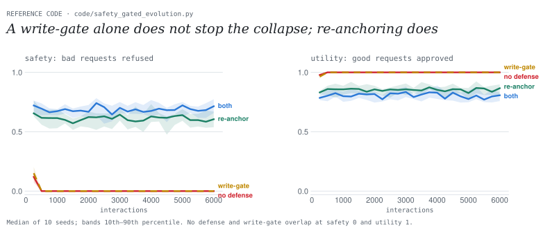</picture>
</p>

<p align="center">
  <picture><source media="(prefers-color-scheme: dark)" srcset="assets/sim-pareto-dark.svg">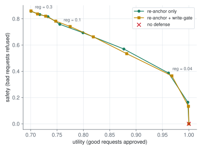</picture>
</p>

```bash
cd code
python3 auto_mas.py
python3 safety_gated_evolution.py   # prints the numbers and writes quick plots to the current directory
```

The figures above are drawn from the same code, over ten seeds, by [`.github/scripts/build_figures.py`](.github/scripts/build_figures.py). See [`docs/primer.md`](docs/primer.md) for a line-by-line reading of `safety_gated_evolution.py` that maps each concept to its code.

---

## A reading path

**If you are new to the idea:** primer → *Why Do Multi-Agent LLM Systems Fail?* → *Your Agent May Misevolve* → run `safety_gated_evolution.py`.

**If you want to build automated design:** GPTSwarm → ADAS → AFlow → MaAS → ABSTRAL, then `auto_mas.py`.

**If you care about deployment-time learning:** Reflexion → EvoTest → TT-SI → TMEM → TAME.

**If you care about recursive self-improvement:** Gödel Agent → Darwin Gödel Machine → the RSI survey → Generalized Agent Iteration → AI4AI-Bench → *Auditing Harness Tampering*.

**If you care about evaluation:** the surveys' benchmark sections → StuLife → Evo-Memory → SkillFlow.

---

## Updates

A running log so you can see what changed without diffing. Newest first.

- **2026-11-10** — Presentation pass; no entry added, removed, or reworded. Paper lists render as tables with venue, arXiv, and code badges. The evolution map now shows six threads and where each branched, through November 2026, with the question each asks. New [Field trends](#field-trends) section: the list's growth by quarter, METR's time-horizon trend, the *AI 2027* forecasts, and Anthropic's S-1/A. The primer figure and the reference-code plots were redrawn from the simulation over ten seeds, for light and dark themes.
- **2026-11-09** — Added 28 papers from 2026-10-28 to 2026-11-05. Harness evolution: new search methods (*HarnessFlow*, *Harness-S*, *Meta^2*, *Latent Harness*, *EnvOpt*, *Exo*) and the evaluations that check them (*Beneath the Surface*, *The Harness Is the Model*, a portable harness specification), plus evidence that evolved harnesses forget (*Can Coding Agents Sustain Continual Evolution without Forgetting?*). Failure analysis: *Artifact-to-Capability* (Reflexion, Voyager, and DGM each show the usual signals of improvement without forming the capability), criteria exposure in embodied self-improvement, and misattributed numbers in papers written by research agents. Safety: self-evolution weakens resistance to indirect prompt injection, and acceptance gates erode redundant safeguards (*Masked Erosion*). Benchmarks and environments: *SelfImprove-Bench*, *Continual AutoResearch*, *CLR-Bench*, *CompressionBench*, *RSI-Env*. Community contributions: *EvoRepair* (@Tomsawyerhu, #44), *SwarmEvolve* (@Qile-J, #45), and *Sage* on the [project board](COMMUNITY.md) (@ZHangZHengEric, #43). Removed a stray blank line that split the coding-agents list.
- **2026-10-28** — Added 44 papers from 2026-09-21 to 2026-10-28, a month in which most new work turned from building self-improving loops to checking them. Evaluation of the loop itself: *The Self-Improvement Problem* (in general, no terminating gate can be both sound and complete), *REUSE* and *The Winner's Curse* (benchmark reuse inflates kept gains), *Auditing the Product, Not the Recursion*, and for harnesses *Harness-Delta Attribution*, *What Does a Harness Buy? Tokens, Mostly*, *Elicitation or Expansion?*, and the ARC-AGI-3 study. Autonomous post-training and research (*Athanor*, *Epi*, research world models, *LM2LM*); safety under RSI (*RSI Control Arena*, *Evolutionary Safety*, *SEABench*, compositional harness failures); and new benchmarks (*Doc2Harness*, *Continual Learning Exam*, *EvalResearchBench*, *RSIGym*, *ParetoRSI-Gym*, *AutoDataBench*, *Trace Evolution Bench*). Community contributions merged since the last pass: *EFRE* (@markovchain-builder, #35), *Recursive Harness Distillation* (@yeonn1e, #37), and *MAIOS Project Kernel* on the [project board](COMMUNITY.md) (@GrazianoGuiducci, #34). Domain-specific variants that apply an existing loop to one field were left out; every description was written from the current arXiv abstract and its numbers checked against it.
- **2026-09-23 (second pass)** — Re-ran the arXiv search with a client arXiv still answers, from 2025-10 onward rather than from 2026-05, and added 36 papers the earlier passes could not see. From before May: *Hyperagents* (self-modification that edits the improver itself), *ACE*, *Nested Learning*, *TTT-Discover*, *Live-SWE-agent*, *Agentic Harness Engineering*, *ALMA*, *Dr. Zero*, *OpenSIR*, theory on the statistical limits of self-improvement and on evolution among self-designing AIs, and safety work on memory misevolution (*MemEvoBench*, *Zombie Agents*). From the last week: the AIDE² paper, *Reflections on Trusting Trust, Revisited* (poisoned benchmarks that self-modifying coding agents evolve against), *Self-Healing Harness*, *Bad Genius*, and *Hill Sampling*.
- **2026-09-23** — Added a [harness evolution](#harness-evolution) section (*RRSI* from Google Research, *SoL-Pi*, *DarwinX*, *Self-Harness*, *Harness-Zero*, and the evaluations that test them). Added the pre-2026 recursive self-improvement work the list was missing (*STOP*, *Self-Rewarding Language Models*, *Huxley-Gödel Machine*, AlphaEvolve's *Mathematical exploration and discovery at scale*, *ShinkaEvolve*), autonomous post-training and collective autoresearch to the RSI section, and a cluster on measuring self-improvement honestly (*PACE*, *Phantom Gains*, *Memory Reward Inflation*, *The Blind Curator*). Every description was written from the paper's current arXiv abstract, and every number in it checked against that abstract.
- **2026-09** — Added a [recursive self-improvement](#recursive-self-improvement) section (*Dream-RSI*, *ModularRSI*, *HELIX*, *Meta^n*, the Gödel-machine successors, and the 1,250-paper RSI survey), RSI benchmarks (*AI4AI-Bench*, *RSIBench-Data*, *PAST-Bench*, *Meta-Agent Challenge*, *S3Gym*), and the failure and safety work that came with them (*self-authored verification*, *harness tampering*, *skill misevolution*). Linked *Gödel Agent* and corrected its title. A second pass re-read every new description against its abstract and softened five that claimed more than the paper shows, moved *AREX* to test-time learning, linked the six remaining entries that had no link, and corrected the paper count, which had been counting bullet lines rather than papers.
- **2026-09** — Added three sections: [zero-data self-evolution](#zero-data-self-evolution-and-self-play) (*Absolute Zero*, *R-Zero*, *Tool-R0*), [self-evolving coding agents](#self-evolving-coding-agents) following the August survey, and [forgetting, drift, and stability](#forgetting-drift-and-stability) (*Do Self-Evolving Agents Forget?*, *anytime-valid certificates*, *SSGM*). Merged four community entries (*OpenSkill*, *RewardHarness*, *ForeDreamer*, *HAT*). Ran a link-verification pass over the whole list: every arXiv identifier now resolves to a paper whose title matches, one wrong title was corrected (the agentic-framework bug study), three more were corrected against arXiv metadata (*EvoMAS*, *Six Sigma Agent*, *ABSTRAL*), and the two entries with no paper are linked to their canonical repositories.
- **2026-07** — Community layer: [`COMMUNITY.md`](COMMUNITY.md) project board, [contributing guide](docs/contributing-guide.md), issue/PR templates, and spotlight strip above.
- **2026-07** — Initial public release: 90+ papers across 13 topics, four-pathway taxonomy, misevolution safety section, primer, and two runnable reference implementations.

> Watching the repo (top-right of the page) is the reliable way to get these — the `last-commit` badge above updates on every merge.

---

## How this list is maintained

A few notes on process, because a curated list is only as good as its upkeep:

- **Entries are read, not scraped.** Each one gets a single neutral sentence describing what the work *does*. If a description reads like a press release, it hasn't been reviewed yet — open an issue.
- **Links are checked, not guessed.** Every arXiv identifier in the list has been resolved against the arXiv API and its title compared with the entry's, so no link here is a guess. Where a work has no stable paper ID, the entry links its canonical repository instead; where neither exists, it is kept without a link and marked `needs-link` rather than given a fabricated one. No entry currently carries that marker.
- **The link policy is enforced by CI.** [`.github/workflows/link-check.yml`](.github/workflows/link-check.yml) re-resolves every arXiv identifier through the arXiv API, compares the returned title with the entry's, and requests every other link — on each pull request and once a month. A broken or mislabelled link fails the check.
- **Monthly review pass.** Roughly once a month the newest work is triaged into the taxonomy and the [Updates](#updates) log is appended. The date in the banner reflects the last pass.
- **Scope is enforced.** New sub-areas are added only when several papers justify them, to keep the list walkable rather than exhaustive. See [related lists](#related-lists) for wider, more encyclopedic coverage.

Found something wrong or missing? Corrections are the most welcome PRs of all — see [CONTRIBUTING.md](CONTRIBUTING.md).

---

## Star history

<p align="center">
  <a href="https://star-history.com/#sukoji/awesome-self-evolving-agents&Date">
    
  </a>
</p>

---

## Beyond papers

Where the labs, courses, and press are on the same questions. Checked by the same link check as everything else.

**Lab reports and essays**

- **When AI Builds Itself** — Anthropic, 2026. [anthropic.com](https://www.anthropic.com/institute/recursive-self-improvement). How much of AI development is already automated, what full recursive self-improvement would take, and why it is not inevitable.
- **Automated Weak-to-Strong Researcher** — Anthropic, 2026. [alignment.anthropic.com](https://alignment.anthropic.com/2026/automated-w2s-researcher/). Autonomous agents proposing and testing ideas on weak-to-strong supervision recovered 0.97 of the performance gap in five days, against 0.23 from human tuning.
- **AIDE²: First Evidence of Recursive Self-Improvement** — Weco, 2026. [weco.ai](https://www.weco.ai/blog/first-evidence-of-recursive-self-improvement). An outer agent rewrites an inner research agent's code over many iterations; the post also says what it did not achieve and that the evolved code grows hard to maintain.
- **The Darwin Gödel Machine** — Sakana AI, 2025. [sakana.ai](https://sakana.ai/dgm/). The accessible account of the [paper](#self-evolving-coding-agents).
- **AlphaEvolve** — Google DeepMind, 2025. [deepmind.google](https://deepmind.google/blog/alphaevolve-a-gemini-powered-coding-agent-for-designing-advanced-algorithms/). The launch post, including the improvements AlphaEvolve made to Google's own training and compute.
- **The What & When of Self-Evolving Agents** — Xinming Tu, 2026. [xinmingtu.cn](https://xinmingtu.cn/blog/2026/self-evolving-agents/). A short conceptual map of the field.

**Courses and workshops**

- **Stanford CS329A: Self-Improving AI Agents** — [cs329a.stanford.edu](https://cs329a.stanford.edu/).
- **ICLR 2026 Workshop on Recursive Self-Improvement** — [recursive-workshop.github.io](https://recursive-workshop.github.io/).

**The sceptical case**

- **AI's recursive self-improvement might not come so quickly after all** — MIT Technology Review, 2026. [technologyreview.com](https://www.technologyreview.com/2026/08/18/1142188/ai-recursive-self-improvement/). Agents handle research engineering but not the creative judgment open-ended research needs.
- **Recursive Self-Improvement Edges Closer in AI Labs** — IEEE Spectrum, 2026. [spectrum.ieee.org](https://spectrum.ieee.org/recursive-self-improvement). Humans still set the goals, define success, and decide which changes to keep.

---

## Related lists

This list is curated to be walkable rather than exhaustive; these go wider and are worth watching:

- [ANative-Lab/Awesome-Self-Evolving-Agents](https://github.com/ANative-Lab/Awesome-Self-Evolving-Agents) — companion to the *Comprehensive Survey*.
- [selfimproving-agent/Awesome-Self-Improving-Agents](https://github.com/selfimproving-agent/awesome-Self-Improving-Agents) — companion to *Self-Improvements in Modern Agentic Systems: A Survey*; organized by foundation-model versus scaffolding improvement, with benchmark tables and talks.
- [XMUDeepLIT/Awesome-Self-Evolving-Agents](https://github.com/XMUDeepLIT/Awesome-Self-Evolving-Agents) — companion to the *What/When/How/Where* survey.

If a paper here is mis-attributed or missing a stable link, that is on this list, not on those.

---

## Contributing

This list is maintained by the community. Pick your lane:

| Contribution | Where | How |
|---|---|---|
| **Paper** | `README.md` | [Suggest paper](https://github.com/sukoji/awesome-self-evolving-agents/issues/new?template=suggest-paper.yml) or PR |
| **OSS project / benchmark** | [`COMMUNITY.md`](COMMUNITY.md) | [Suggest project](https://github.com/sukoji/awesome-self-evolving-agents/issues/new?template=suggest-project.yml) or PR |
| **Fix** | either file | [Correction issue](https://github.com/sukoji/awesome-self-evolving-agents/issues/new?template=correction.yml) — fastest merge |

Full walkthrough: [docs/contributing-guide.md](docs/contributing-guide.md) · rubric: [CONTRIBUTING.md](CONTRIBUTING.md) · conduct: [CODE_OF_CONDUCT.md](CODE_OF_CONDUCT.md).

Short version: **one entry per PR**, one neutral sentence, verifiable link (or explicit `needs-link`), correct section/pathway tag.

## License

[CC0 1.0](LICENSE) for the list itself. The code under [`code/`](code/) is MIT — see [`code/LICENSE`](code/LICENSE).
